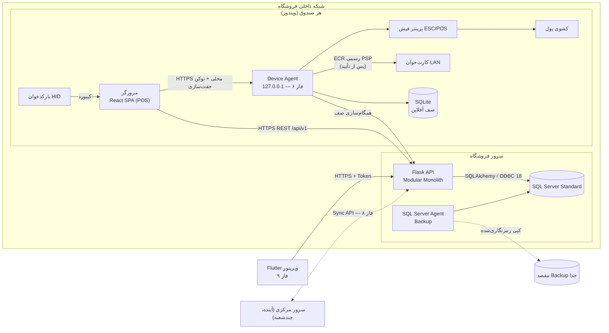
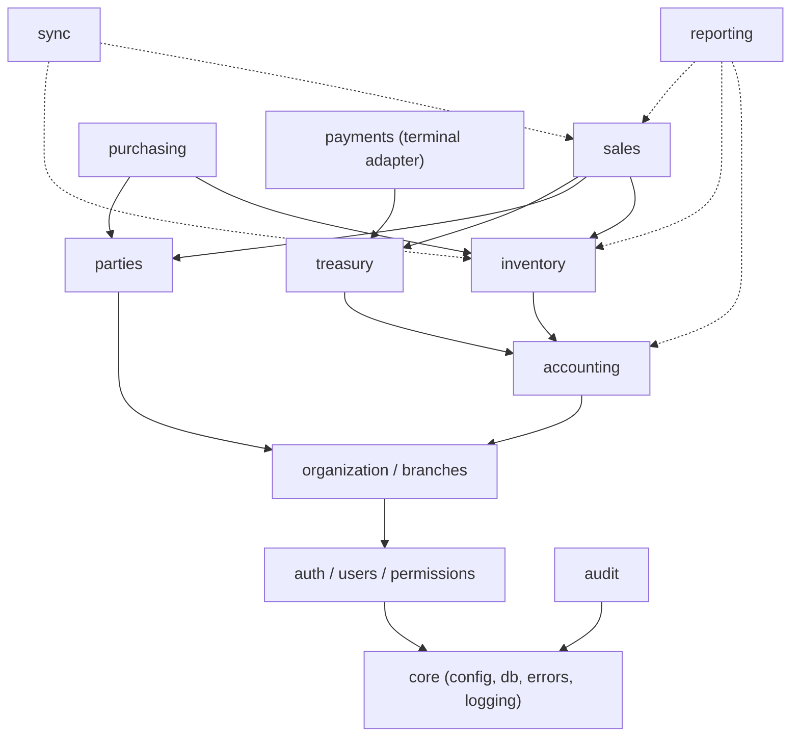

# معماری کلان و نیازمندی‌ها

## ۱. نیازمندی‌ها و فرضیات

### فرضیات تأییدشده
| # | فرض | منبع |
|---|---|---|
| F1 | تک‌مستأجر: هر مشتری یک نصب و یک دیتابیس | مالک محصول |
| F2 | مشتری اول: سوپرمارکت، ابتدا یک شعبه | مالک محصول |
| F3 | SQL Server **2019 Standard** روی سیستم محلی (سرور: Core i3 نسل ۸، ۴GB RAM — ریسک R1) | مالک محصول |
| F4 | مؤدیان در نسخه بعد | مالک محصول |
| F5 | پایلوت: ۳ تا ۷ صندوق، حداقل ۱۰۰۰ فاکتور در روز | مالک محصول |
| F6 | کارت‌خوان بانک ملت؛ پرینتر فیش USB؛ کالاها بخشی مشمول و بخشی معاف مالیات | مالک محصول |
| F7 | نمایش تومان، سال مالی از ۱ فروردین، موجودی منفی با هشدار، بدون باشگاه مشتریان، بدون انتقال داده | مالک محصول |
| F8 | Backup روی همان سیستم، جابه‌جایی دستی توسط اپراتور (ریسک R2) | مالک محصول |

پاسخ‌ها و ریسک‌ها: [`open-questions.md`](../open-questions.md).

### فرضیات کاری (نیازمند تأیید)
| # | فرض |
|---|---|
| A2 | صندوق‌ها ویندوز ۱۰/۱۱ با Chrome یا Edge |
| A3 | سرور (یا یکی از سیستم‌ها) در شبکه داخلی فروشگاه Backend و SQL Server را اجرا می‌کند |
| A4 | در فاز پایلوت، کارت‌خوان‌ها مستقل (غیرمتصل) کار می‌کنند و صندوق‌دار شماره پیگیری را دستی ثبت می‌کند |
| A5 | بارکدخوان‌ها Keyboard Wedge با پسوند Enter |
| A6 | ترازوی برچسب‌زن EAN-13 تولید می‌کند (الگوی دقیق از عکس برچسب واقعی گرفته می‌شود) |
| A7 | تعداد کالا ۱۰ تا ۳۰ هزار |

### نیازمندی‌های غیرعملکردی (هدف، نه تضمین — تا آزمون بار)
- بار هدف: ۷ صندوق هم‌زمان، ۳۰۰۰ فاکتور در روز، پیک ۴ فاکتور در ثانیه.
- جست‌وجوی بارکد در صندوق: p95 زیر ۱۰۰ms در شبکه داخلی با ۵۰ هزار کالا.
- ثبت نهایی فاکتور (فروش + انبار + سند): p95 زیر ۵۰۰ms.
- مصرف حافظه Backend محدود و قابل اجرا در کنار SQL Server روی سرور ۴GB (اندازه‌گیری در فاز ۴).
- قطع اینترنت هیچ اثری بر حالت شبکه داخلی ندارد؛ قطع شبکه داخلی ← حالت آفلاین (فاز ۸).
- RPO پایلوت: ۱۵ دقیقه برای خرابی دیتابیس (Log Backup)؛ برای خرابی کامل سیستم = زمان آخرین کپی دستی Backup به بیرون (ریسک R2)؛ RTO: ۲ ساعت.

## ۲. نمودار اجزا



**قواعد مرزی:**
- مرورگر، موبایل و Agent هرگز مستقیم به SQL Server وصل نمی‌شوند.
- Agent فقط روی `127.0.0.1` گوش می‌دهد؛ هیچ API اجرای فرمان یا SQL ندارد.
- کارت‌خوان فقط از Agent و فقط از پروتکل رسمی.
- بارکدخوان HID به Agent نیاز ندارد.

## ۳. لایه‌های Backend

```
HTTP → api (Blueprint) → schemas (Pydantic) → services (منطق کسب‌وکار، Unit of Work)
                                             ├→ domain rules (توازن، موجودی، Posting Rules)
                                             ├→ repository (SQLAlchemy)
                                             ├→ audit
                                             └→ permissions (چک در service و api)
```
- هر عملیات کسب‌وکار = یک `unit_of_work()` = یک تراکنش. خطا ← rollback کامل.
- ماژول‌ها فقط سرویس عمومی یکدیگر را صدا می‌زنند (مثلاً `sales` ← `inventory.services.issue_stock` و `accounting.services.post_voucher`).

### ماژول‌ها و وابستگی


## ۴. حالت‌های استقرار
1. **شبکه داخلی (پایلوت):** همه چیز در فروشگاه. اینترنت لازم نیست.
2. **سرور مرکزی:** Backend و SQL Server روی سرور (میزبانی در ایران)؛ شعب از طریق HTTPS/VPN.
3. **ترکیبی (فاز ۸):** هر شعبه Backend محلی + همگام‌سازی با مرکز طبق [`sync/protocol.md`](../sync/protocol.md).
