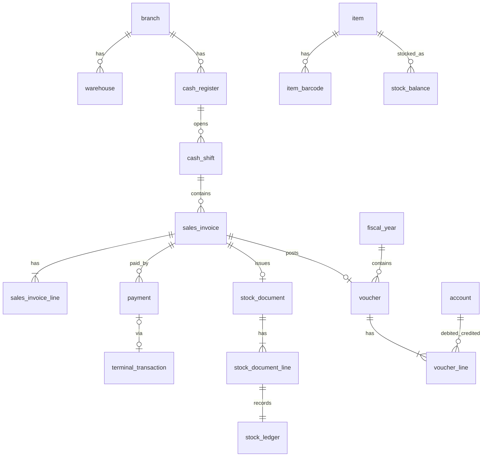

# مدل اولیه داده

قراردادهای عمومی (ADR-0006، ADR-0008):
- همه جداول: `id UNIQUEIDENTIFIER PK`، `created_at`، `updated_at` (DATETIMEOFFSET UTC)، `created_by`، `updated_by`.
- جداول قابل ویرایش: `row_version ROWVERSION`.
- جداول عملیاتی: `branch_id` (FK).
- مبلغ `DECIMAL(19,4)` ریال؛ مقدار `DECIMAL(19,3)`.
- اسناد قطعی: فقط وضعیت تغییر می‌کند (برگشت/ابطال)؛ حذف فیزیکی ممنوع (trigger یا مجوز DB `DENY DELETE`).

## ۱. پلتفرم (فاز ۱)
| جدول | ستون‌های کلیدی | نکته |
|---|---|---|
| `organization` | name, display_currency (`IRR`/`IRT`، پیش‌فرض IRT), timezone, negative_stock_policy (پیش‌فرض warn), last_offsite_backup_at | دقیقاً یک ردیف |
| `branch` | code (UQ), name, is_active | |
| `cash_register` | branch_id, code (UQ per branch), name, payment_terminal_id? | صندوق |
| `app_user` | username (UQ), password_hash, is_active, failed_attempts, locked_until, mfa_secret? | |
| `role` | code (UQ), name, is_system | |
| `permission` | code (UQ) مثل `sales.invoice.void` | ثابت، از کد seed می‌شود |
| `role_permission` | role_id, permission_id | PK مرکب |
| `user_role` | user_id, role_id | |
| `user_scope` | user_id, branch_id, warehouse_id?, cash_register_id? | محدوده دسترسی |
| `user_session` | user_id, device, ip, created_at, expires_at, revoked_at | |
| `audit_event` | occurred_at, user_id, branch_id, action, entity_type, entity_id, before_json, after_json, ip | append-only، بدون UPDATE/DELETE |
| `idempotency_record` | key (UQ با user_id), endpoint, request_hash, status_code, response_json, created_at | پاک‌سازی پس از ۷ روز |
| `number_sequence` | doc_type, branch_id, fiscal_year_id, next_value | UQ(doc_type, branch_id, fiscal_year_id) |

## ۲. حسابداری (فاز ۲)
| جدول | ستون‌های کلیدی | نکته |
|---|---|---|
| `account` | code (UQ), name, level (group/general/subsidiary), parent_id, nature (debit/credit/both), is_postable, is_active | درختی |
| `detail_account` | code (UQ), name, type (party/cost_center/bank/...), ref_id? | تفصیلی |
| `fiscal_year` | title, start_date, end_date, status (open/closing/closed) | |
| `fiscal_period` | fiscal_year_id, start_date, end_date, is_locked | |
| `voucher` | branch_id, fiscal_year_id, number?, document_date, status (draft/provisional/final/reversed), source_type, source_id, description, reversed_by_id? | سند |
| `voucher_line` | voucher_id, line_no, account_id, detail_account_id?, debit, credit, description | CHECK (debit>=0 AND credit>=0 AND (debit=0 OR credit=0)) |
| `posting_rule` | event_type, line_role, account_id, detail_source, side | [`posting-rules.md`](../architecture/posting-rules.md) |

Index: `voucher_line(account_id, voucher_id)` شامل debit/credit؛ `voucher(fiscal_year_id, status, document_date)`.

## ۳. کالا و انبار (فاز ۳)
| جدول | ستون‌های کلیدی | نکته |
|---|---|---|
| `item_group` | code, name, parent_id | |
| `unit` | code, name | |
| `item` | code (UQ), name, group_id, base_unit_id, item_type (goods/service), is_weighted, track_expiry, vat_exempt, vat_rate, tax_item_code?, min_qty, max_qty, is_active | `vat_exempt` (معاف) جدا از `vat_rate` (نرخ صفر ≠ معاف)؛ `tax_item_code` رزرو مؤدیان |
| `item_unit` | item_id, unit_id, factor | تبدیل به واحد پایه |
| `item_barcode` | barcode (UQ), item_id, item_unit_id? | **Index اصلی جست‌وجوی صندوق** |
| `scale_barcode_rule` | prefix, item_code_start/len, value_start/len, value_type (weight/price), divisor | |
| `price_list` / `price_list_item` | price_list_id, item_id, unit_id, price, valid_from, valid_to | |
| `warehouse` | branch_id, code, name | |
| `stock_document` | branch_id, warehouse_id, type (receipt/issue/transfer_out/transfer_in/adjustment/count), number, document_date, status, source_type, source_id | |
| `stock_document_line` | stock_document_id, item_id, qty (پایه), unit_cost, total_cost, batch_no?, expiry_date? | |
| `stock_ledger` | item_id, warehouse_id, posted_at, document_line_id, qty_in, qty_out, unit_cost, balance_qty, balance_avg_cost | **کاردکس**؛ append-only؛ clustered (item_id, warehouse_id, seq) |
| `stock_balance` | item_id, warehouse_id, qty, avg_cost, row_version | کش موجودی؛ فقط در همان تراکنش ledger به‌روز می‌شود |

## ۴. فروش و صندوق (فاز ۴)
| جدول | ستون‌های کلیدی | نکته |
|---|---|---|
| `cash_shift` | cash_register_id, user_id, opened_at, opening_cash, closed_at, counted_cash, expected_cash, difference, status | |
| `sales_invoice` | branch_id, cash_register_id, shift_id, customer_id?, device_number (UQ), number?, document_date, status (draft/held/final/voided), subtotal, discount_total, tax_total, grand_total, original_invoice_id? (برگشت), voucher_id, tax_invoice_number?, tax_submission_status? | فیلدهای `tax_*` رزرو |
| `sales_invoice_line` | invoice_id, line_no, item_id, unit_id, qty, unit_price, discount, tax, line_total, promotion_id?, scanned_barcode | |
| `promotion` | name, type (percent/amount/buy_x_get_y), scope (item/group), value, valid_from, valid_to, is_active | |
| `payment` | invoice_id, method (cash/card/credit), amount, terminal_transaction_id? | پرداخت ترکیبی = چند ردیف |
| `payment_terminal` | code, model, psp?, ip?, compatibility_status | |
| `terminal_transaction` | terminal_id, invoice_id, request_id (UQ), amount, status (Created/Pending/Approved/Declined/Unknown/ReconciliationRequired/Cancelled), rrn?, trace_no?, masked_pan?, raw_response_redacted, is_simulated | هرگز PAN کامل/PIN |

## ۵. طرف‌حساب، خرید، خزانه (فاز ۵) — خلاصه
`party` (type: person/company، national_id، economic_code، postal_code، credit_limit، roles: customer/supplier)، `party_contact`، `purchase_order(_line)`، `purchase_invoice(_line)` (+ هزینه جانبی)، `cash_box`، `bank_account`، `receipt` / `disbursement`، `cheque` (direction، status، due_date، history)، `bank_statement_line`.

## ۶. همگام‌سازی (فاز ۸)
`sync_device`، `sync_inbox` (operation_id UQ، device_id، payload، received_at، status، error)، `sync_conflict`.

## روابط اصلی

