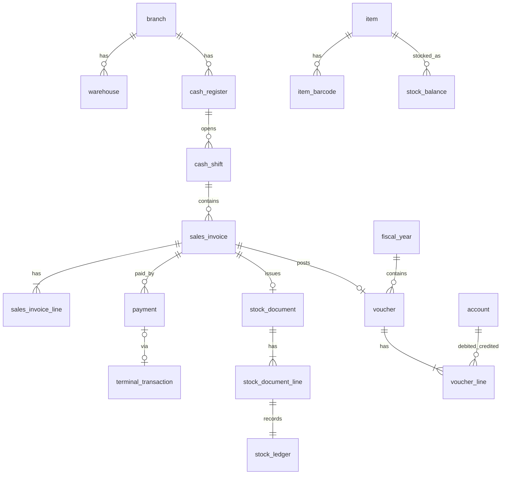

# مدل اولیه داده

قراردادهای عمومی (ADR-0006، ADR-0008):
- همه جداول: `id UNIQUEIDENTIFIER PK`، `created_at`، `updated_at` (DATETIMEOFFSET UTC)، `created_by`، `updated_by`.
- جداول قابل ویرایش: `row_version ROWVERSION`.
- جداول عملیاتی: `branch_id` (FK).
- مبلغ `DECIMAL(19,4)` ریال؛ مقدار `DECIMAL(19,3)`.
- اسناد قطعی: فقط وضعیت تغییر می‌کند (برگشت/ابطال)؛ حذف فیزیکی ممنوع (trigger یا مجوز DB `DENY DELETE`).

## ۱. پلتفرم (فاز ۱)
| جدول | ستون‌های کلیدی | نکته |
|---|---|---|
| `organization` | name, display_currency (`IRR`/`IRT`، پیش‌فرض IRT), timezone, negative_stock_policy (پیش‌فرض warn), last_offsite_backup_at | دقیقاً یک ردیف |
| `branch` | code (UQ), name, is_active | |
| `cash_register` | branch_id, code (UQ per branch), name, payment_terminal_id? | صندوق |
| `app_user` | username (UQ), password_hash, is_active, failed_attempts, locked_until, mfa_secret? | |
| `role` | code (UQ), name, is_system | |
| `permission` | code (UQ) مثل `sales.invoice.void` | ثابت، از کد seed می‌شود |
| `role_permission` | role_id, permission_id | PK مرکب |
| `user_role` | user_id, role_id | |
| `user_scope` | user_id, branch_id, warehouse_id?, cash_register_id? | محدوده دسترسی |
| `user_session` | user_id, device, ip, created_at, expires_at, revoked_at | |
| `audit_event` | occurred_at, user_id, branch_id, action, entity_type, entity_id, before_json, after_json, ip | append-only، بدون UPDATE/DELETE |
| `idempotency_record` | key (UQ با user_id), endpoint, request_hash, status_code, response_json, created_at | پاک‌سازی پس از ۷ روز |
| `number_sequence` | doc_type, branch_id, fiscal_year_id, next_value | UQ(doc_type, branch_id, fiscal_year_id) |

## ۲. حسابداری (فاز ۲)
| جدول | ستون‌های کلیدی | نکته |
|---|---|---|
| `account` | code (UQ), name, level (group/general/subsidiary), parent_id, category (asset/liability/equity/revenue/expense), nature (debit/credit/none), requires_detail, is_active, is_system | درختی |
| `detail_account` | code (UQ), name, kind (person/bank/cash/cost_center/project/other), is_active | تفصیلی |
| `fiscal_year` | title, jalali_year (UQ), start_date, end_date, status (open/closed), closed_at | |
| `fiscal_period` | fiscal_year_id, start_date, end_date, is_locked | |
| `voucher` | branch_id? (NULL = سطح سازمان: افتتاحیه/اختتامیه), fiscal_year_id, number? (فقط قطعی), document_date, status (draft/final), source_type (manual/auto/reversal/opening/closing), source_ref, source_id, total_debit, total_credit, reversal_of_id?, reversed_by_id? | سند — ADR-0011؛ trigger تغییرناپذیری |
| `voucher_line` | voucher_id, line_no, account_id, detail_account_id?, debit, credit, description | CHECK (debit>=0 AND credit>=0 AND (debit=0 OR credit=0)) |
| `posting_rule` | event_type, line_role (UQ با هم), account_id | [`posting-rules.md`](../architecture/posting-rules.md)؛ کاتالوگ رویدادها در `accounting/defaults.py` |
| `number_sequence` | doc_type, fiscal_year_id, branch_id? (UQ), next_value | شماره بدون فاصله با قفل ردیفی |

Index: `voucher_line(account_id, voucher_id)` شامل debit/credit؛ `voucher(fiscal_year_id, status, document_date)`.

## ۳. کالا و انبار (فاز ۳) — پیاده‌شده (migration `0004`)
| جدول | ستون‌های کلیدی | نکته |
|---|---|---|
| `item_group` | code (UQ), name, parent_id | |
| `unit` | code (UQ), name, allows_fraction | پیش‌فرض: عدد، کیلوگرم، گرم، لیتر، بسته، کارتن، جعبه، متر |
| `item` | code (UQ), name, group_id, base_unit_id, item_type (goods/service), is_weighted, scale_code (UQ فیلترشده), track_expiry, vat_exempt, vat_rate, tax_item_code?, min_qty, max_qty, is_active | `vat_exempt` (معاف) جدا از `vat_rate` (نرخ صفر ≠ معاف)؛ `tax_item_code` رزرو مؤدیان |
| `item_unit` | item_id, unit_id, factor | تبدیل به واحد پایه (UQ item+unit) |
| `item_barcode` | barcode (UQ), item_id, unit_id? | **Index اصلی جست‌وجوی صندوق**؛ `unit_id` برای بارکد بسته/کارتن |
| `scale_barcode_rule` | name, prefix, item_code_length, value_length, value_type (weight/price), value_decimals, is_active | CHECK: طول پیشوند + کد + مقدار = ۱۲؛ پیشوندها هم‌پوشانی ندارند |
| `price_list` / `item_price` | price_list_id, item_id, unit_id, price | فهرست پیش‌فرض RETAIL؛ قیمت برای هر واحد جدا |
| `warehouse` | branch_id, code, name, is_active | یک انبار اصلی برای هر شعبه خودکار ساخته می‌شود |
| `stock_document` | branch_id, warehouse_id, dest_warehouse_id?, doc_type (opening/adjustment/transfer/count), number, document_date, status (draft/final), voucher_id?, source_document_id? | شمارش پس از قطعی شدن یک سند تعدیل مرتبط می‌سازد |
| `stock_document_line` | document_id, item_id, unit_id, qty, base_qty, unit_cost?, total_cost?, system_qty?, expiry_date? | |
| `stock_ledger` | seq (identity), item_id, warehouse_id, document_id, document_line_id, document_date, posted_at, qty_in, qty_out, value_in, value_out, balance_qty, balance_value, avg_cost | **کاردکس**؛ append-only با trigger؛ clustered (item_id, warehouse_id, seq) |
| `stock_balance` | PK (item_id, warehouse_id), qty, value, avg_cost, last_movement_date | فقط در همان تراکنش ledger و با قفل ردیف به‌روز می‌شود (ADR-0012) |

> رسید خرید و حواله فروش در فاز ۴ و ۵ با همین `post_movement` ثبت می‌شوند؛ جدول جدا برای آن‌ها ساخته نمی‌شود.

## ۴. فروش و صندوق (فاز ۴) — پیاده‌شده (migration `0005`)
| جدول | ستون‌های کلیدی | نکته |
|---|---|---|
| `cash_shift` | branch_id, cash_register_id, user_id, status (open/closed), opened_at, opening_cash, closed_at, closed_by, expected_cash, counted_cash, difference, voucher_id | ایندکس یکتای فیلترشده: یک شیفت باز برای هر صندوق و هر کاربر |
| `sales_invoice` | branch_id, cash_register_id, shift_id, fiscal_year_id, warehouse_id, kind (sale/return), status (draft/held/recalled/final), number, document_date, customer_id (تفصیلی شخص)، original_invoice_id، subtotal، discount_total، tax_total، grand_total، cost_total، cash_tendered، change_due، voucher_id، stock_document_id، tax_invoice_number?، tax_submission_status? | شماره یکتا در (سال، شعبه، نوع)؛ trigger: فاکتور قطعی تغییر یا حذف نمی‌شود؛ `tax_*` رزرو مؤدیان |
| `sales_invoice_line` | invoice_id, line_no, item_id, unit_id, qty, base_qty, unit_price, price_source (list/scale), gross, promotion_id, promotion_discount, manual_discount, vat_exempt, vat_rate, tax, revenue, line_total, cost_total, scanned_barcode, original_line_id | trigger: ردیف فاکتور قطعی تغییرناپذیر |
| `sales_payment` | invoice_id, seq, method (cash/card/credit), amount, card_reference?, terminal_transaction_id? | کارت بدون شماره پیگیری یا تراکنش تأییدشده ممنوع (CHECK)؛ هر تراکنش کارت‌خوان فقط یک پرداخت |
| `promotion` | name, kind (percent/amount), scope (item/group), item_id/group_id, value, starts_on, ends_on, is_active | |
| `sales_approval` | action (line_delete/discount_over_limit), cash_register_id, requested_by, approved_by, expires_at, used_at | تأیید سرپرست، یک‌بارمصرف |
| `terminal_transaction` | request_id (UQ), cash_register_id, cart_id, adapter_id, amount, status (Created…Cancelled), rrn, trace_no, masked_pan, response_code, is_simulated, resolved_by, resolution_note | هرگز PAN کامل یا PIN |
| `backup_log` | kind (backup/restore_test), status, started_at, finished_at, file_path, size_bytes, verified, message | |

تغییر جداول قبلی: `organization` (default_vat_rate، prices_include_vat، cashier_discount_limit، backup_warning_days، receipt_header/footer)، `detail_account.credit_limit`، `stock_document` (انواع `sale`/`sale_return` و source_type/source_id). دیتابیس با `READ_COMMITTED_SNAPSHOT` (ADR-0013).

## ۵. طرف‌حساب، خرید، خزانه (فاز ۵) — پیاده‌شده (migrationهای `0007` تا `0009`، ADR-0014)
| جدول | ستون‌های کلیدی | نکته |
|---|---|---|
| `party` | id (= `detail_account.id`)، party_type (person/company)، is_customer، is_supplier، group_id، national_id، economic_code، registration_no، phone، mobile، email، postal_code، city، address، payment_terms_days | دست‌کم یک نقش (CHECK)؛ national_id یکتا (فیلترشده)؛ سقف اعتبار همان `detail_account.credit_limit` |
| `party_group` | code، name | |
| `party_note` | party_id، body، follow_up_on، done، created_by | پیگیری‌های سررسیده |
| `purchase_order` / `_line` | branch_id، warehouse_id، supplier_id، status (draft/approved/closed/cancelled)، number، order_date، expected_date · ردیف: item_id، unit_id، qty، base_qty، unit_cost | |
| `purchase_invoice` | kind (invoice/return)، status (draft/final)، branch_id، warehouse_id، supplier_id، number، document_date، supplier_invoice_no/date، due_date، order_id، original_invoice_id، subtotal، discount_total، tax_total، charges_total، grand_total، cost_total، voucher_id، stock_document_id | trigger: قطعی تغییرناپذیر؛ شماره یکتا در (سال، شعبه، نوع) |
| `purchase_invoice_line` | qty، base_qty، unit_cost، gross، discount، net، vat_rate، tax، landed، total_cost، expiry_date، order_line_id، original_line_id | landed = سهم هزینه جانبی؛ total_cost = net + landed |
| `purchase_charge` | description، amount، payee_id (NULL = تأمین‌کننده) | |
| `money_account` | id (= `detail_account.id` از نوع cash/bank)، kind، branch_id، bank_name، bank_branch، account_no، iban | مانده از اسناد قطعی |
| `treasury_document` | kind (receipt/payment/transfer/settlement)، status (draft/final/reversed)، number، document_date، party_id، against، from/to_account_id، amount، fee، voucher_id، reversal_voucher_id | trigger: فقط final ← reversed |
| `treasury_line` | method (cash/bank/cheque)، money_account_id، amount، reference، cheque_id | |
| `cheque` | direction (received/issued)، status، party_id، number، sayad_id، bank_name، drawer، amount، due_date، money_account_id، document_id | مشخصات تغییرناپذیر (trigger)؛ صیادی یکتا در هر جهت |
| `cheque_event` | cheque_id، seq، event_date، from_status، to_status، money_account_id، voucher_id، note | append-only (trigger) |
| `bank_statement_line` | money_account_id، seq، line_date، amount (± )، description، reference، balance، fingerprint، voucher_line_id | (حساب، fingerprint) یکتا؛ voucher_line_id یکتا (فیلترشده) |

تغییر جداول قبلی: `stock_document.doc_type` به ۱۶ نویسه با انواع `purchase` و `purchase_return`.

## ۵-الف. دستگاه‌های صندوق (فاز ۶) — پیاده‌شده (migration `0010`، ADR-0015)
| جدول | ستون‌های کلیدی | نکته |
|---|---|---|
| `device` | name، branch_id، cash_register_id، status (pending/active/revoked)، pairing_code_hash، pairing_expires_at، token_hash، paired_at، last_seen_at، agent_version، platform، printer_state، printer_transport (none/tcp/windows/serial)، printer_address، paper_width (58/80)، cut_paper، drawer_enabled، drawer_pin (2/5) | یک دستگاه فعال برای هر صندوق (ایندکس فیلترشده)؛ کد و توکن فقط hash |
| `device_job` | device_id، kind (receipt/drawer/test)، status (queued/sent/done/failed/expired)، payload (JSON داده، نه بایت)، source_id (فاکتور)، attempts، sent_at، finished_at، error | بیش از ۲ دقیقه در صف ← expired؛ تکرار خودکار ندارد |

## ۵-ب. گزارش‌ها (فاز ۷) — migration `0011`
| جدول | ستون‌های کلیدی | نکته |
|---|---|---|
| `saved_report_filter` | user_id، report، name، params (JSON) | یکتا در (کاربر، گزارش، نام)؛ اشتراکی نیست |

## ۶. همگام‌سازی (فاز ۸)
`sync_device`، `sync_inbox` (operation_id UQ، device_id، payload، received_at، status، error)، `sync_conflict`.

## روابط اصلی

