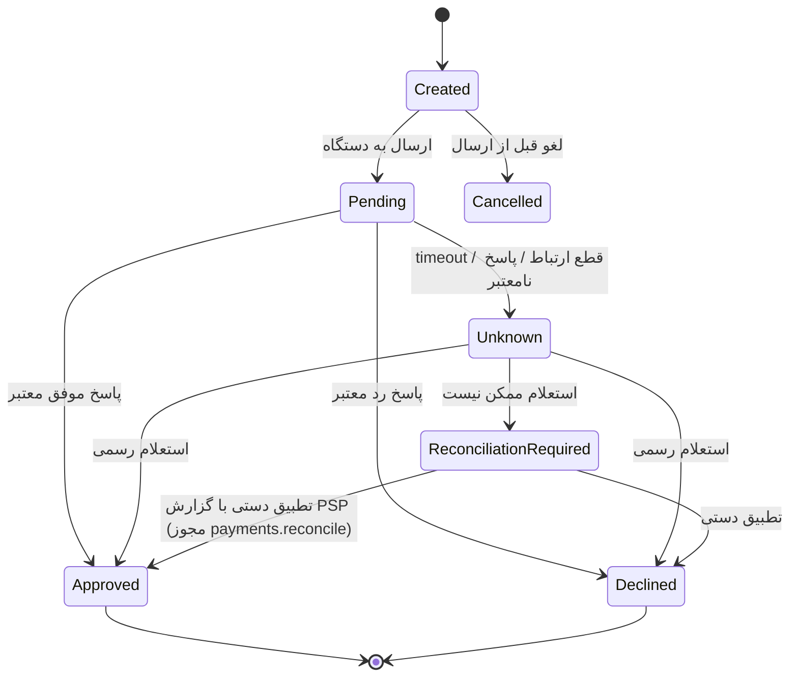

# قرارداد عمومی Payment Terminal Adapter

> هیچ مدل، PSP، SDK یا پروتکلی پیش‌فرض سازگار نیست. این سند فقط قرارداد مستقل از برند است.
> وضعیت همه کارت‌خوان‌ها: **Not Verified** تا آزمون واقعی.

## ۱. اجزا
| جزء | محل | مسئولیت |
|---|---|---|
| `PaymentTerminalService` | backend `payments` | ایجاد درخواست، ثبت وضعیت، پیوند به فاکتور، جلوگیری از تکرار |
| `PaymentReconciliationService` | backend | صف تراکنش‌های Unknown/ReconciliationRequired؛ تطبیق با گزارش PSP |
| `PaymentAuditService` | backend | ممیزی هر تغییر وضعیت (بدون داده حساس) |
| `PaymentTerminalAdapter` (interface) | device-agent | ارتباط با یک مدل دستگاه |
| `PaymentTerminalAdapterFactory` | device-agent | انتخاب adapter از رجیستری سازگاری |
| `TerminalConnectionManager` | device-agent | اتصال، timeout، قفل یک تراکنش هم‌زمان برای هر دستگاه |
| `MockPaymentTerminalAdapter` | device-agent | فقط dev/test |

## ۲. Interface (Python، مفهومی)
```python
class TerminalStatus(StrEnum): ONLINE, OFFLINE, BUSY, ERROR

class TxStatus(StrEnum):
    CREATED = "Created"; PENDING = "Pending"; APPROVED = "Approved"
    DECLINED = "Declined"; UNKNOWN = "Unknown"
    RECONCILIATION_REQUIRED = "ReconciliationRequired"; CANCELLED = "Cancelled"

@dataclass(frozen=True)
class PaymentRequest:
    request_id: UUID          # = terminal_transaction.request_id، یکتا
    invoice_ref: str          # device_number فاکتور
    amount_rial: Decimal      # > 0
    terminal_id: str

@dataclass(frozen=True)
class PaymentResult:
    request_id: UUID
    status: TxStatus
    rrn: str | None; trace_no: str | None; masked_pan: str | None   # فقط ۶ رقم اول و ۴ رقم آخر
    response_code: str | None
    raw_redacted: dict         # پاسخ خام پس از حذف داده حساس
    is_simulated: bool

class PaymentTerminalAdapter(Protocol):
    adapter_id: str; version: str
    capabilities: frozenset[str]   # {"sale", "inquiry", "void", "refund"} — فقط موارد تأییدشده رسمی
    def status(self) -> TerminalStatus: ...
    def start_sale(self, req: PaymentRequest, timeout_s: float) -> PaymentResult: ...
    def inquire(self, request_id: UUID) -> PaymentResult: ...       # اگر پشتیبانی نشود: NotSupported
    def void(self, request_id: UUID) -> PaymentResult: ...           # اختیاری
    def refund(self, original: PaymentResult, amount: Decimal) -> PaymentResult: ...  # اختیاری
```

## ۳. ماشین وضعیت


## ۴. قواعد الزامی
1. برای هر فاکتور در هر لحظه حداکثر یک تراکنش `Pending/Unknown/ReconciliationRequired`؛ شروع پرداخت جدید تا روشن‌شدن وضعیت **مسدود** است (UI: «نیازمند بررسی»).
2. نتیجه فقط وقتی پذیرفته می‌شود که `request_id` و مبلغ با درخواست مطابقت داشته باشد.
3. timeout ← `Unknown`؛ هرگز `Declined` خودکار.
4. `Approved` فقط از پاسخ دستگاه یا استعلام رسمی یا تطبیق دستی ممیزی‌شده.
5. `is_simulated=true` در production رد می‌شود (Backend و Agent هر دو بررسی می‌کنند).
6. هیچ PAN کامل، Track2، CVV، PIN یا کلید در دیتابیس یا لاگ.
7. یک تراکنش هم‌زمان برای هر دستگاه (قفل در `TerminalConnectionManager`).

## ۵. سناریوهای Mock
`approve` · `decline` · `timeout` · `unknown` · `disconnect` · `delay:<ms>` · `duplicate` · `inquiry_approved` · `inquiry_unavailable` (← ReconciliationRequired).

## ۶. چک‌لیست تأیید یک مدل (پیش از نوشتن کانکتور)
برند و مدل · PSP · Firmware · نوع اتصال · مستند رسمی ECR/SDK و مجوز استفاده · روش ارسال مبلغ · روش دریافت نتیجه · استعلام · کدهای خطا و رفتار timeout · پیش‌نیاز ویندوز · محیط آزمون (ترمینال تست PSP).

## ۷. رجیستری سازگاری
فایل `docs/hardware/compatibility-registry.md` (ساخت در فاز ۶) با ستون‌های: دستگاه، مدل، Firmware، اتصال، SDK/درایور، OS، قابلیت‌های تأییدشده، نسخه کانکتور، تاریخ و شواهد آزمون، محدودیت‌ها، وضعیت.

## ۸. سامان، پی‌سی‌پوز مرکزی (`sep_central`، ADR-0024)
- **مبنا:** «راهنمای پیاده‌سازی سرویس‌های پی سی پوز مرکزی»، نگارش ۱٫۴، سامان کیش.
- **کد:**
  - درایور: `backend/app/modules/sales/services/sep_pcpos.py`
  - شبیه‌ساز آزمون: `backend/tests/sep_fake.py`
- **وضعیت:** Not Verified. فقط با شبیه‌سازی آزموده شده است که از روی مستند ساخته شده؛ سرویس واقعی سامان هنوز آزموده نشده است.
- **مسیر تلاش:** ReciveIdentifier (ذخیره در `provider_ref`) ← Pending ← StartPayment در پس‌زمینه ← Approved / Declined / Unknown. سپس در صورت نیاز Inquery (همیشه با `CancelPendingRequest=false`) یا «لغو ارسال» (`true`).

### چک‌لیست آزمون با محیط آزمایشی سامان (پیش از فروش واقعی)
1. سامان این‌ها را بدهد:
   - نشانی سرویس و سرور هویت؛
   - نام کاربری و رمز کلاینت و کاربر؛
   - یک شماره ترمینال آزمایشی که برای پی‌سی‌پوز مرکزی فعال شده است.
   را در `.env` سرور بگذارید (راهنمای نصب LAN).
2. در «دستگاه‌های صندوق» کارت‌خوان را با ارائه‌دهنده‌ی «پی‌سی‌پوز مرکزی» و شماره‌ی ترمینال تعریف کنید. وضعیت باید «آماده» شود.
3. **خرید موفق** با مبلغ کم. مبلغ روی دستگاه، RRN و شماره‌ی پیگیری روی صفحه با رسید دستگاه یکی باشد.
4. **رمز اشتباه** و **کارت بی‌موجودی**: باید «رد شد» با پیام بانک نمایش داده شود.
5. **لغو روی دستگاه** و **«لغو ارسال» از صفحه** پیش از کشیدن کارت.
6. **بی‌پاسخی:** کابل شبکه‌ی سرور را وسط پرداخت جدا کنید. باید «نامشخص» شود و استعلام وضعیت درست را بدهد.
7. **استعلام هنگام انتظار کارت:** آیا پرداخت لغو نمی‌شود؟ (نکته‌ی ۳ مستند)
8. کد پاسخ هر مرحله و ResponseCode/ErrorCode واقعی را ثبت کنید. به‌ویژه کد ۹ و کد استعلامِ تراکنشِ در انتظار، که مستند روشن نمی‌گوید.
9. نتیجه را در `compatibility-registry.md` ثبت کنید و `verified` را فقط پس از این آزمون درست کنید.
