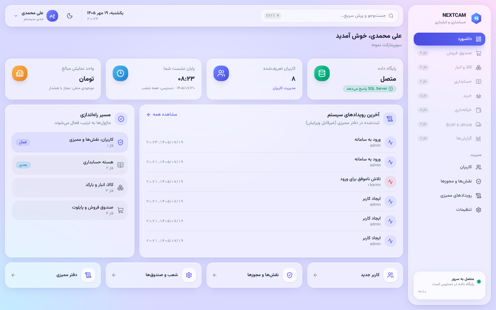

# راهنمای کاربری NEXTCAM

هر کاربر فقط منوها و دکمه‌هایی را می‌بیند که نقشش اجازه می‌دهد. سرور هم هر درخواست را جداگانه بررسی می‌کند.

| نقش | راهنما |
|---|---|
| صندوق‌دار | [cashier.md](cashier.md) |
| سرپرست صندوق | [supervisor.md](supervisor.md) |
| انباردار | [warehouse.md](warehouse.md) |
| کارپرداز خرید | [purchasing.md](purchasing.md) |
| حسابدار و حسابرس | [accountant.md](accountant.md) |
| مدیر فروشگاه | [manager.md](manager.md) |
| مدیر سیستم | [admin.md](admin.md) |
| ویزیتور (اپ اندروید) | [visitor-app.md](visitor-app.md) |

## برای همه

**ورود و رمز**
- نشانی برنامه را مدیر سیستم می‌دهد، مثلاً `https://nextcam.local`.
- بار اول، برنامه می‌خواهد رمز را عوض کنید.
- رمز دست‌کم ۸ نویسه، شامل حرف و عدد، و متفاوت از نام کاربری باشد.
- پس از ۵ رمز اشتباه، حساب ۱۵ دقیقه قفل می‌شود.
- نشست پس از ۲ ساعت بی‌کاری بسته می‌شود.

**تاریخ و عدد**
- تاریخ‌ها شمسی و مبلغ‌ها به **تومان** نمایش داده می‌شوند.
- واحد نمایش در تنظیمات قابل تغییر است؛ در سیستم همه‌چیز به ریال ذخیره می‌شود.
- عدد را با صفحه‌کلید فارسی یا انگلیسی وارد کنید؛ برنامه خودش تبدیل می‌کند.

**جست‌وجوی سریع**
- `Ctrl+K` فهرست صفحه‌ها و فرمان‌ها را باز می‌کند.

**وضعیت‌ها همیشه با متن و نشانه نمایش داده می‌شوند**
- **پیش‌نویس:** قابل ویرایش است.
- **قطعی:** تغییرناپذیر است و فقط با «برگشت» اصلاح می‌شود.
- **برگشت‌خورده**

**اگر خطایی دیدید**
- پیام خطا عمدتاً جزئیات فنی ندارد.
- اگر «شناسه‌ی رخداد» دارد، آن را برای مدیر سیستم بفرستید. با همین شناسه، جزئیات در گزارش سرور پیدا می‌شود.

**ویرایش هم‌زمان**
- اگر کس دیگری همان سند را هم‌زمان تغییر داده باشد، برنامه تغییر شما را ذخیره نمی‌کند و می‌گوید صفحه را تازه کنید.
- هیچ تغییری بی‌صدا روی تغییر دیگری نوشته نمی‌شود.

