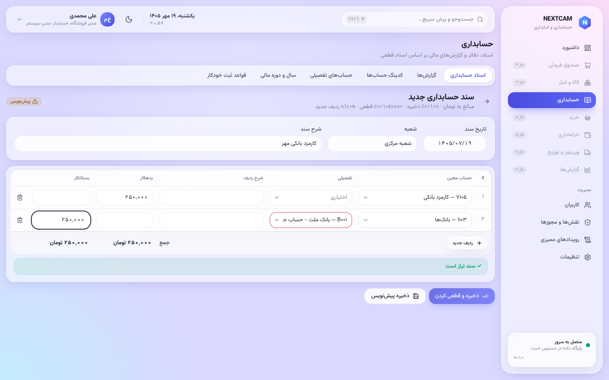
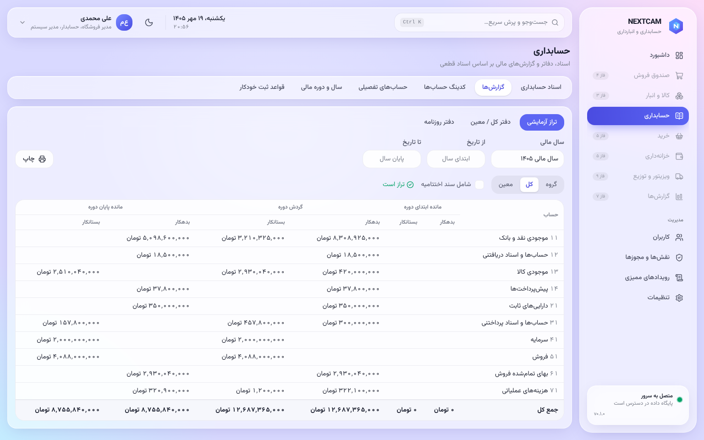
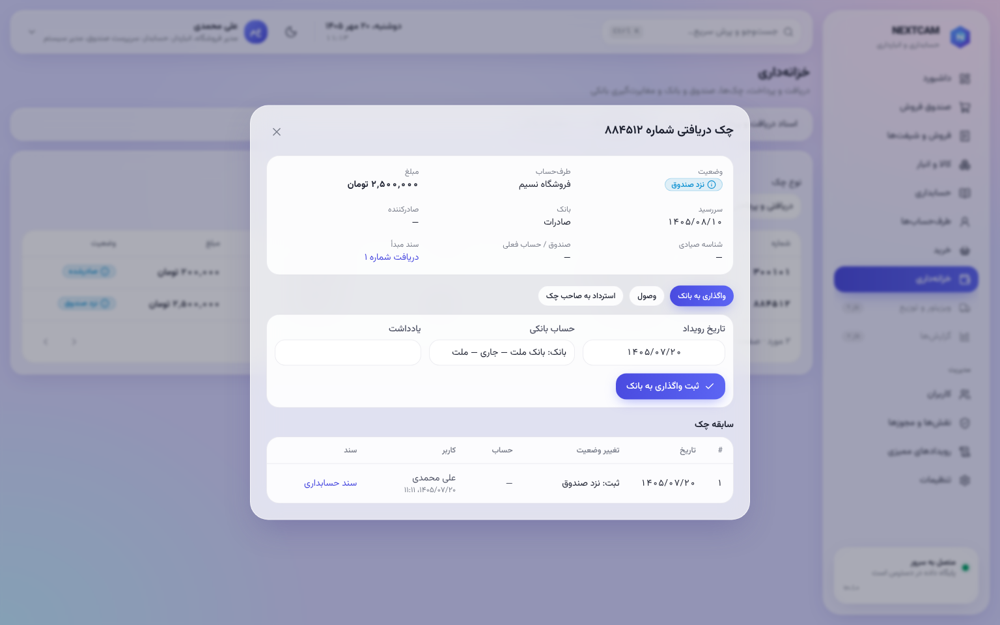
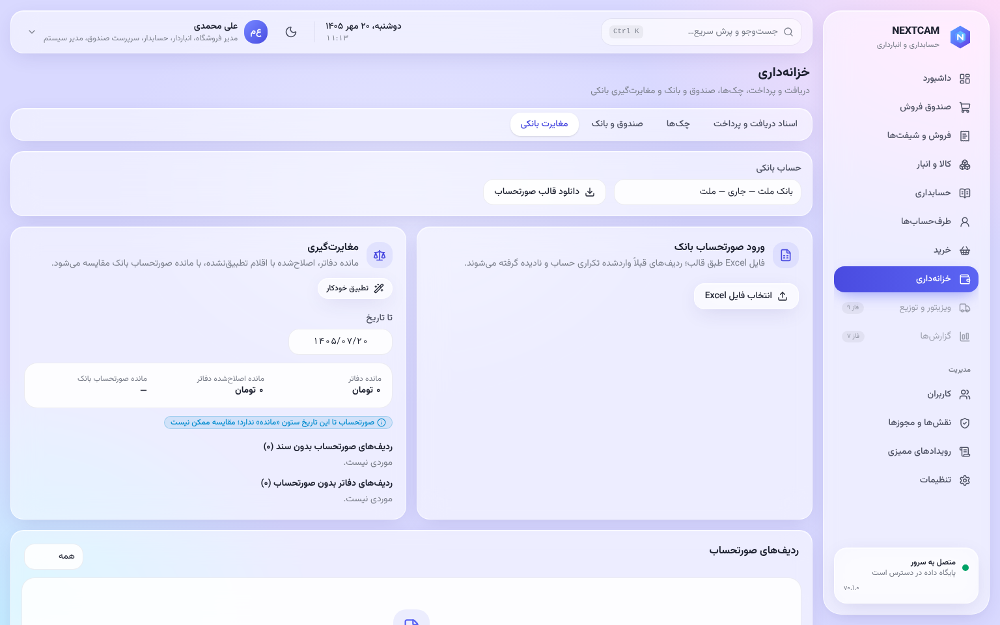
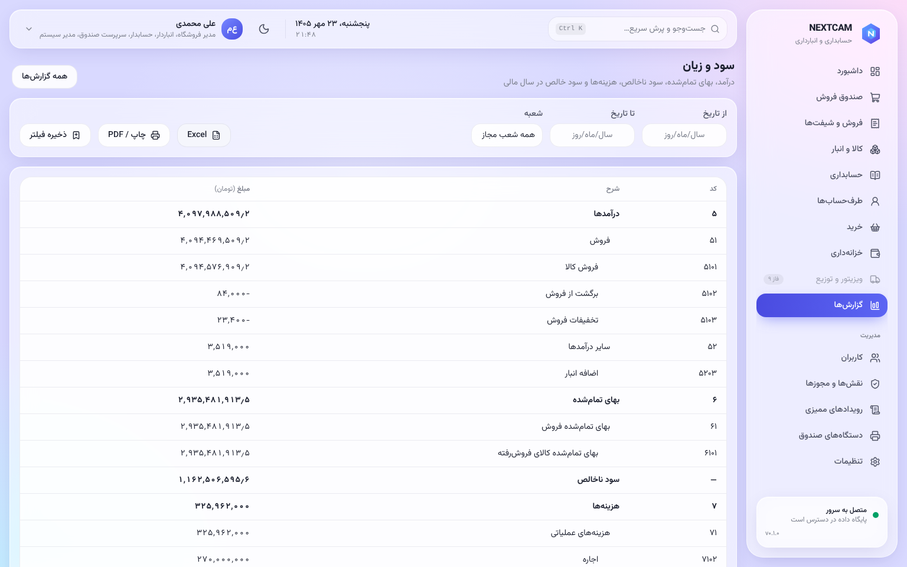

# راهنمای حسابدار (و حسابرس)

**حسابرس** همه‌ی این صفحه‌ها را فقط **می‌بیند** و هیچ ثبتی ندارد.

## اصول
- **سند:** پیش‌نویس ← قطعی ← در صورت نیاز **برگشت** (سند معکوس با ارجاع).
- **سند قطعی** حذف یا ویرایش نمی‌شود. خود دیتابیس هم جلوی آن را می‌گیرد.
- **سند نامتوازن** قطعی نمی‌شود.
- **اسناد خودکار** (فروش، خرید، انبار، خزانه) از **قواعد ثبت** ساخته می‌شوند. برای تغییر حساب‌ها، قاعده را عوض کنید، نه سندها را.

## حسابداری
| صفحه | کار |
|---|---|
| **سرفصل حساب‌ها** | گروه، کل، معین؛ و تفصیلی‌ها (اشخاص، صندوق‌ها، بانک‌ها) |
| **اسناد** | ثبت سند دستی، قطعی کردن، برگشت |
| **تراز آزمایشی** | شش ستونی (اول دوره، گردش، مانده) در سطح گروه، کل یا معین |
| **دفتر حساب** | گردش یک حساب (و تفصیلی) با مانده‌ی جاری |
| **دفتر روزنامه** | — |
| **سال‌های مالی** | بستن سال: اسناد اختتامیه و افتتاحیه خودکار |
| **قواعد ثبت** | حساب هر رویداد (فروش نقدی، کارت، مالیات، بهای تمام‌شده، …) |

 

## خزانه‌داری
| صفحه | کار |
|---|---|
| **دریافت و پرداخت** | از یا به طرف‌حساب، با نقد، بانک یا چک (چند ردیف در یک سند) |
| **انتقال** | بین صندوق و بانک |
| **چک‌ها** | وصول، برگشت، خرج، واگذاری، با تاریخچه‌ی کامل هر چک |
| **تسویه کارت‌خوان** | واریز بانک در برابر فروش‌های کارتی |
| **مغایرت بانکی** | ورود صورت‌حساب بانک (Excel)، تطبیق خودکار و دستی، اقلام باز |

 

## طرف‌حساب‌ها
- **صورت‌حساب هر شخص:** فاکتورها، دریافت‌ها، چک‌ها، مانده.
- **سقف اعتبار:** فروش نسیه و سفارش ویزیتور از آن بیشتر نمی‌شود.
- یادداشت و پیگیری (یادآوری).

## گزارش‌ها
- **سود و زیان**؛
- **ترازنامه**؛
- **بدهکاران و بستانکاران با سن بدهی**؛
- **گردش وجوه**.

همه قابل چاپ و خروجی Excel هستند.

