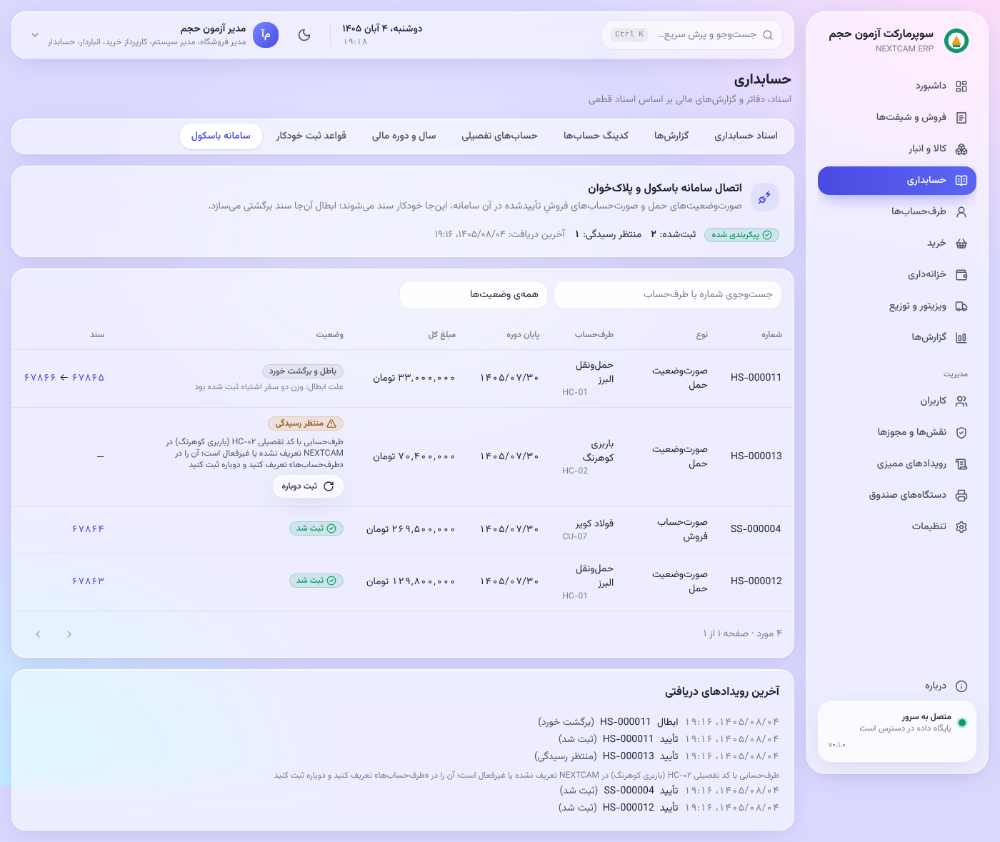

# راهنمای حسابدار (و حسابرس)

**حسابرس** همه‌ی این صفحه‌ها را فقط **می‌بیند** و هیچ ثبتی ندارد.

## اصول
- **سند:** پیش‌نویس ← قطعی ← در صورت نیاز **برگشت** (سند معکوس با ارجاع).
- **سند قطعی** حذف یا ویرایش نمی‌شود. خود دیتابیس هم جلوی آن را می‌گیرد.
- **سند نامتوازن** قطعی نمی‌شود.
- **اسناد خودکار** (فروش، خرید، انبار، خزانه) از **قواعد ثبت** ساخته می‌شوند. برای تغییر حساب‌ها، قاعده را عوض کنید، نه سندها را.

## حسابداری
| صفحه | کار |
|---|---|
| **سرفصل حساب‌ها** | گروه، کل، معین؛ و تفصیلی‌ها (اشخاص، صندوق‌ها، بانک‌ها) |
| **اسناد** | ثبت سند دستی، قطعی کردن، برگشت |
| **تراز آزمایشی** | شش ستونی (اول دوره، گردش، مانده) در سطح گروه، کل یا معین |
| **دفتر حساب** | گردش یک حساب (و تفصیلی) با مانده‌ی جاری |
| **دفتر روزنامه** | — |
| **سال‌های مالی** | بستن سال: اسناد اختتامیه و افتتاحیه خودکار |
| **قواعد ثبت** | حساب هر رویداد (فروش نقدی، کارت، مالیات، بهای تمام‌شده، …) |
| **سامانه باسکول** | صورت‌وضعیت‌های حمل و فروش که از سامانه باسکول و پلاک‌خوان رسیده‌اند و سند هرکدام |

**سامانه باسکول و پلاک‌خوان.**
- هر صورت‌وضعیت که آن‌جا تأیید شود، این‌جا خودکار یک سند قطعی می‌شود، به تاریخ پایان دوره.
- ابطال آن‌جا، این‌جا سند برگشتی می‌سازد. سند اصلی دست نمی‌خورد.
- «منتظر رسیدگی» یعنی سند ساخته نشد و علتش کنار ردیف نوشته شده است. معمول‌ترین علت‌ها:
  - طرف‌حسابی با آن کد تفصیلی تعریف نشده است؛
  - سال مالی آن تاریخ باز نیست؛
  - حساب قاعده‌ی ثبت تعریف نشده است.
- مشکل را رفع کنید و «ثبت دوباره» بزنید. این کار مجوز `accounting.integration.manage` را می‌خواهد.

 

## خزانه‌داری
| صفحه | کار |
|---|---|
| **دریافت و پرداخت** | از یا به طرف‌حساب، با نقد، بانک یا چک (چند ردیف در یک سند) |
| **انتقال** | بین صندوق و بانک |
| **چک‌ها** | وصول، برگشت، خرج، واگذاری، با تاریخچه‌ی کامل هر چک |
| **تسویه کارت‌خوان** | واریز بانک در برابر فروش‌های کارتی |
| **مغایرت بانکی** | ورود صورت‌حساب بانک (Excel)، تطبیق خودکار و دستی، اقلام باز |

 

### وصول ویزیتورها
- **ویزیتور و توزیع ← وصول وجه:** پولی که ویزیتور از مشتری گرفته (نقد، چک، کارت‌به‌کارت). تا تأیید شما در مانده‌ی مشتری اثری ندارد.
- **تأیید:** صندوق یا حساب بانکی را انتخاب کنید. سند دریافت در خزانه‌داری ثبت می‌شود (چک به چک‌های دریافتی می‌رود) و شماره‌ی سند برای ویزیتور فرستاده می‌شود.
- **رد:** با دلیل؛ ویزیتور دلیل را در اپ می‌بیند.
- مجوز: `treasury.manage`.

## طرف‌حساب‌ها
- **صورت‌حساب هر شخص:** فاکتورها، دریافت‌ها، چک‌ها، مانده.
- **فروش نسیه** برای هر مشتری یکی از سه حالت است:
  - **ندارد:** فروش نسیه و تأیید سفارش نسیه رد می‌شود.
  - **با سقف اعتبار:** فروش نسیه و سفارش ویزیتور از سقف بیشتر نمی‌شود.
  - **نامحدود:** بدون سقف. فقط برای مشتریان مورد اعتماد؛ مانده‌ی بدهی هر قدر شود فروش رد نمی‌شود. تغییر آن در ممیزی ثبت می‌شود.
  - در ورود از Excel، در ستون «سقف اعتبار» کلمه‌ی «نامحدود» را بنویسید.
- یادداشت و پیگیری (یادآوری).

## گزارش‌ها
- **سود و زیان**؛
- **ترازنامه**؛
- **بدهکاران و بستانکاران با سن بدهی**؛
- **گردش وجوه**.

همه قابل چاپ و خروجی Excel هستند.

