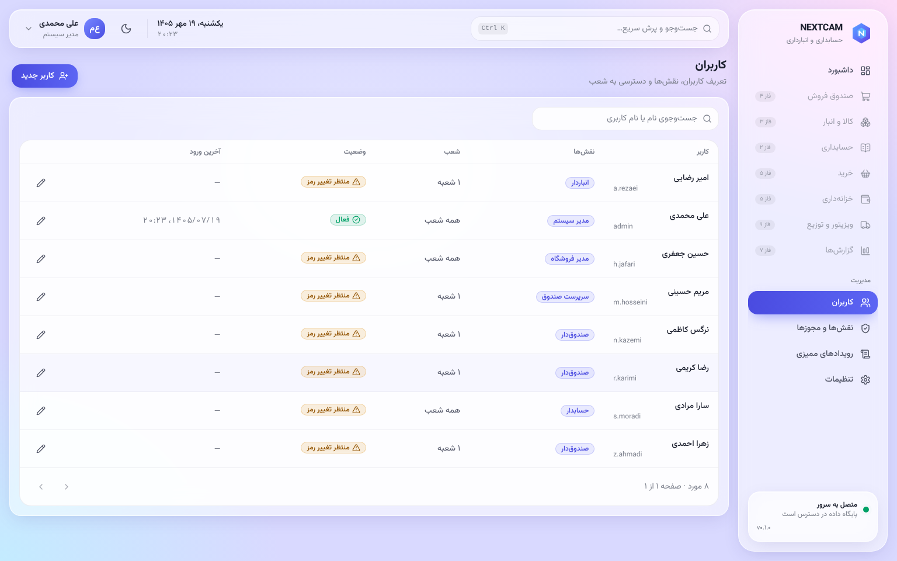
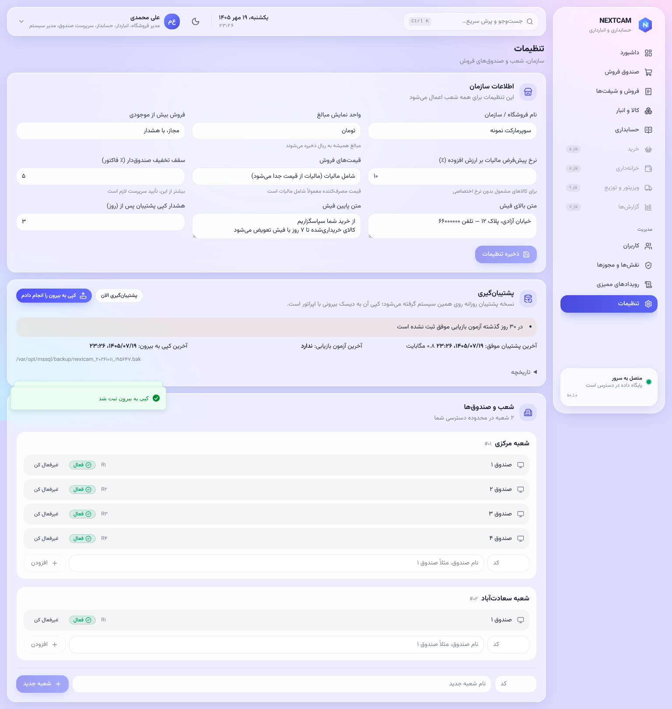

# راهنمای مدیر سیستم

نصب، به‌روزرسانی و HTTPS: [../install/windows-installer.md](../install/windows-installer.md)، [../install/upgrade.md](../install/upgrade.md)، [../install/https.md](../install/https.md).

## کاربران و نقش‌ها
- **«کاربران»:** تعریف کاربر، نقش‌ها و **محدوده‌ی شعبه**. کاربر یک شعبه، سند شعبه‌ی دیگر را نمی‌بیند.
  - **غیرفعال کردن کاربر**، نشست‌های وب و اپ او را فوراً قطع می‌کند.
  - **حذف کاربر** وجود ندارد. سابقه‌ها به کاربر ارجاع دارند.
- **«نقش‌ها و مجوزها»:**

  | نقش | دسترسی |
  |---|---|
  | مدیر سیستم | کاربران، نقش‌ها و تنظیمات؛ **نه** عملیات مالی |
  | مدیر فروشگاه | — |
  | حسابدار | — |
  | سرپرست صندوق | — |
  | صندوق‌دار | — |
  | انباردار | — |
  | کارپرداز | — |
  | حسابرس | فقط خواندن |
  | ویزیتور | فقط اپ |

  نقش جدید با مجموعه‌ی دلخواه مجوزها هم ممکن است.

## رویدادهای ممیزی
**«رویدادهای ممیزی»:** همه‌ی کارهای حساس با کاربر، زمان و IP ثبت می‌شوند. این رویدادنگار حذف‌شدنی نیست. نمونه‌ها:
- ورود و ورود ناموفق؛
- تأییدها؛
- حذف ردیف صندوق؛
- برگشت‌ها؛
- تغییر قیمت؛
- نصب مجوز؛
- پشتیبان‌گیری؛
- به‌روزرسانی.

## تنظیمات
- **سازمان:**
  - واحد نمایش؛
  - نرخ مالیات پیش‌فرض؛
  - سیاست موجودی منفی؛
  - سقف تخفیف صندوق‌دار؛
  - متن سر و ته فیش.
- **شعب و صندوق‌ها.**
- **پشتیبان‌گیری:**
  - آخرین پشتیبان، آخرین کپی رمزنگاری‌شده (مقصد دوم) و آخرین آزمون بازیابی؛
  - دکمه‌ی «پشتیبان‌گیری الان»؛
  - هشدارها در داشبورد مدیر هم نمایش داده می‌شوند.
- **مجوز نرم‌افزار:** کد درخواست و نصب مجوز ([../install/license.md](../install/license.md)). نسخه‌ی برنامه و دیتابیس هم همین‌جا نمایش داده می‌شود.

## کارهای دوره‌ای
| کار | دوره |
|---|---|
| بررسی هشدارهای داشبورد (پشتیبان، مجوز، کسری صندوق) | روزانه |
| بررسی `C:\nextcam\logs\backup.log` و موفق بودن آزمون بازیابی | هفتگی |
| `flask check-integrity` | ماهانه |
| مرور رویدادهای ممیزی | ماهانه |
| غیرفعال کردن کاربرانی که رفته‌اند | ماهانه |
| آزمون بازیابی روی **رایانه‌ی دیگر** با کلید پشتیبانِ نگهداری‌شده ([../install/lan-install.md](../install/lan-install.md) بخش ۸.۱) | سالانه |
