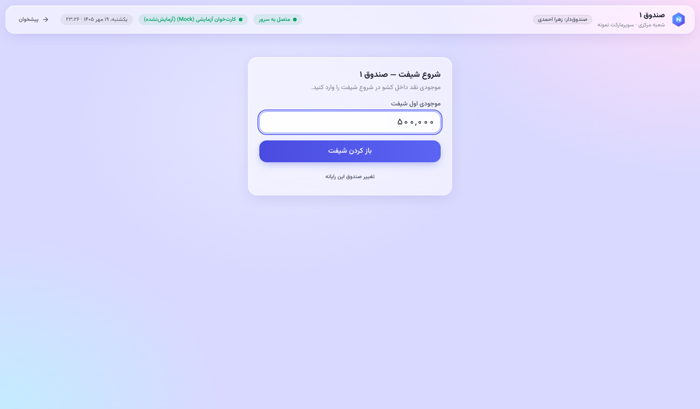
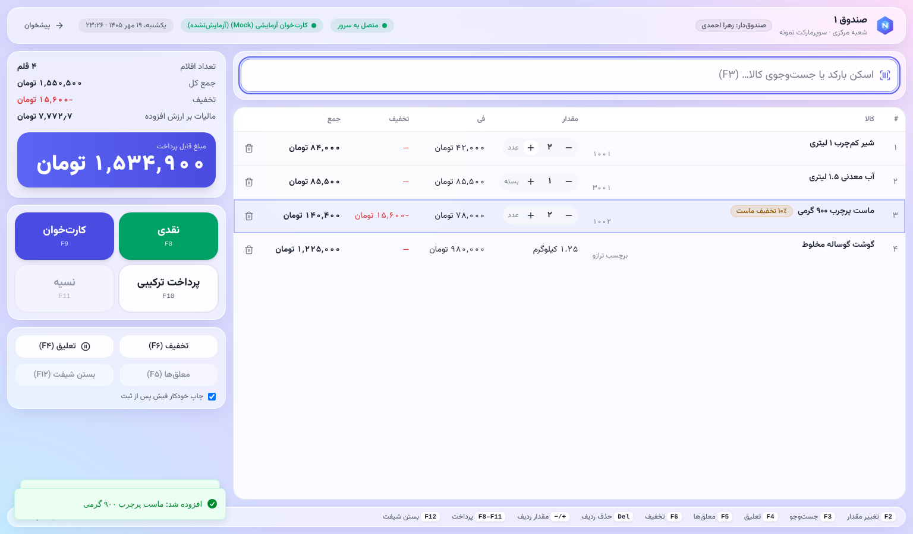
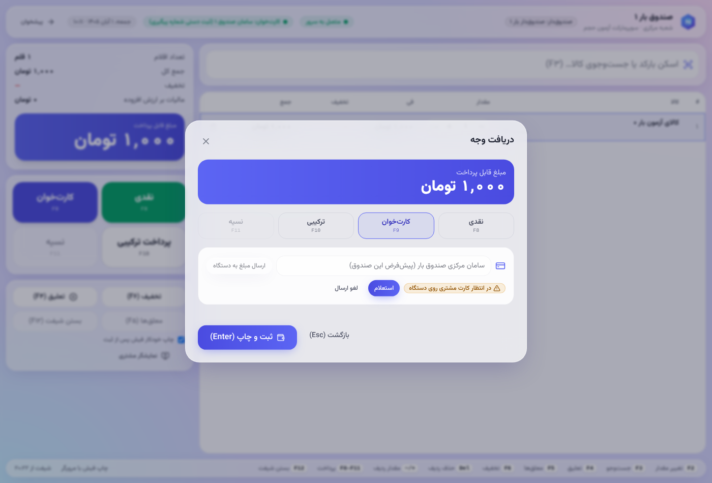
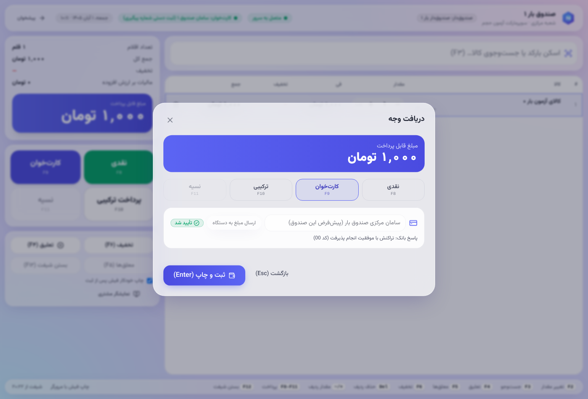
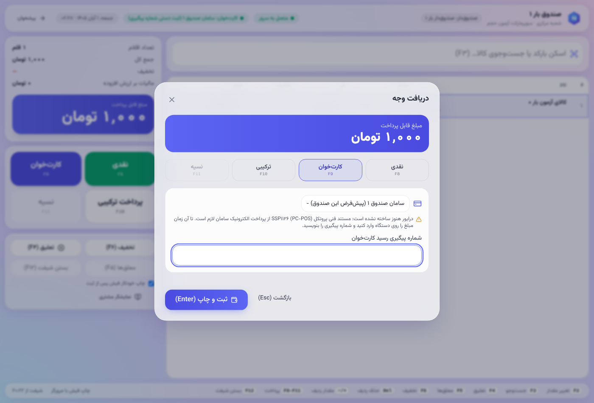
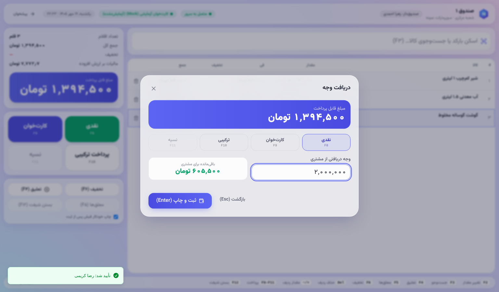
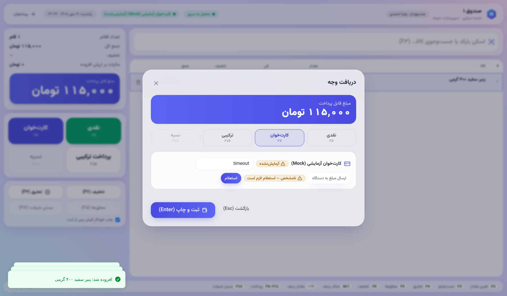
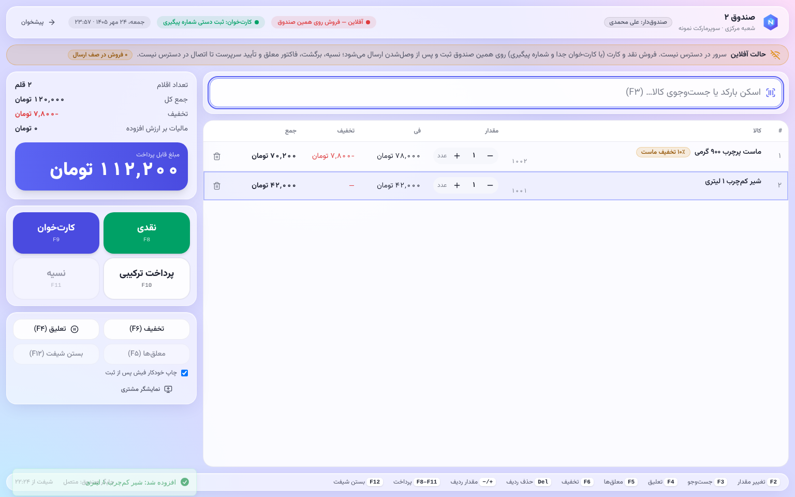
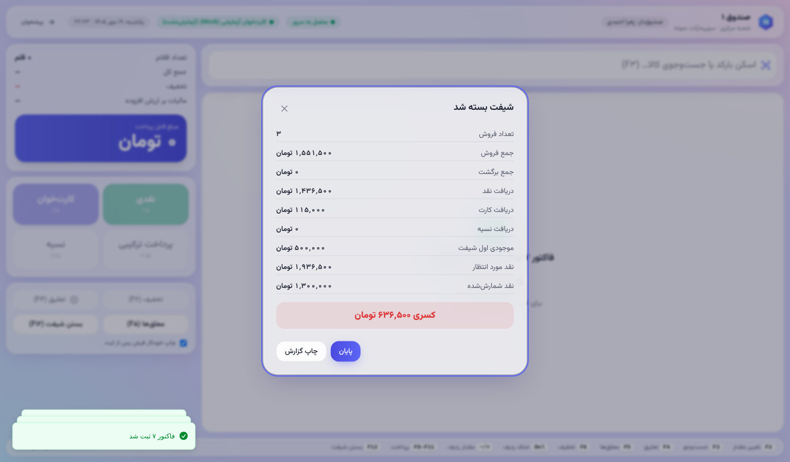

# راهنمای صندوق‌دار

صفحه‌ی کار شما **صندوق فروش** است: منوی «صندوق فروش» یا نشانی `/pos`. اگر صندوق Device Agent دارد، آدرس `http://127.0.0.1:47616/` است.

## شروع شیفت
1. بار اول، صندوقِ همین رایانه را انتخاب کنید. روی همین مرورگر می‌ماند.
2. **باز کردن شیفت:** موجودی اول کشو (پول خرد) را وارد کنید.

## فروش
- **افزودن کالا:** بارکد را اسکن کنید، یا نام و کد را تایپ کنید و از فهرست انتخاب کنید. برچسب ترازو (وزن یا قیمت) هم با اسکن خوانده می‌شود.
- **قیمت، تخفیف پروموشن و مالیات** را سرور حساب می‌کند. صندوق‌دار قیمت را تغییر نمی‌دهد.
- **مقدار ردیف:** `+` و `−`، یا `F2` برای وارد کردن مقدار.
- **حذف ردیف:** `Del`. حذف ردیف ثبت و برای مدیر قابل گزارش است.

| کلید | کار |
|---|---|
| `F3` | رفتن به کادر اسکن |
| `F2` | تغییر مقدار ردیف انتخاب‌شده |
| `F4` | تعلیق فاکتور (مشتری چیزی جا گذاشته) |
| `F5` | فهرست فاکتورهای معلق |
| `F6` | تخفیف دستی (فقط با تأیید سرپرست، طبق سیاست فروشگاه) |
| `F8` | پرداخت نقدی |
| `F9` | کارت‌خوان |
| `F10` | پرداخت ترکیبی |
| `F11` | نسیه |
| `F12` | بستن شیفت |

## پرداخت
- **نقدی:** مبلغ دریافتی را وارد کنید. باقی‌مانده نمایش داده می‌شود.
- **کارت:** کارت‌خوان پیش‌فرض صندوق از قبل انتخاب شده است؛ اگر مشتری با دستگاه دیگری پرداخت می‌کند، آن را از فهرست انتخاب کنید.
  - اگر کارت‌خوان به نرم‌افزار وصل است، «ارسال مبلغ به دستگاه» را بزنید.
    - تا مشتری کارت بکشد و رمز بزند، «در انتظار کارت مشتری روی دستگاه» نمایش داده می‌شود؛ نتیجه خودکار می‌آید.
    - اگر مشتری منصرف شد، «لغو ارسال» را بزنید. اگر کارت همان لحظه کشیده شده باشد، پرداخت تأییدشده می‌ماند.
    - اگر رد شد، پیام بانک (مثلاً «موجودی کافی نیست») زیر آن نمایش داده می‌شود.
  - اگر نیست (پیام زیر فهرست)، مبلغ را روی دستگاه بزنید و پس از تأیید، **شماره‌ی پیگیری رسید** را وارد کنید.
  - اگر وضعیت پرداخت **نامشخص** بود (قطع ارتباط یا قطع برق)، **دوباره کارت نکشید**.
  - رسید دستگاه را بررسی کنید یا سرپرست را صدا بزنید. «نامشخص» یعنی شاید پول کسر شده باشد.
- **نسیه:** فقط برای مشتری تعریف‌شده و تا سقف اعتبار او (مشتری با اعتبار «نامحدود» سقف ندارد).
- پس از ثبت، فیش چاپ می‌شود و کشو باز می‌شود (با Device Agent).

 
  

## قطع شبکه (فقط صندوق‌های دارای Device Agent)
- نوار «آفلاین» نمایش داده می‌شود و فروش ادامه دارد. فروش‌ها روی همین رایانه نگه داشته و پس از وصل شدن خودکار ارسال می‌شوند.
- در حالت آفلاین:
  - قیمت از آخرین داده‌ی دریافتی است؛
  - شماره‌ی فاکتور موقت است؛
  - **کارت‌خوان یکپارچه و نسیه در دسترس نیست.**
- اگر سرور فروشی را نپذیرد (مثلاً موجودی)، آن فروش برای مدیر در «فروش‌های آفلاین» نمایش داده می‌شود. فروش هرگز بی‌صدا حذف نمی‌شود.

## برگشت از فروش
برگشت با نقش «سرپرست» انجام می‌شود ([supervisor.md](supervisor.md)).

## پایان شیفت
1. `F12` بزنید.
2. پول کشو را **بشمارید** و عدد شمرده‌شده را وارد کنید. برنامه مبلغ مورد انتظار را پیش از شمارش نشان نمی‌دهد.
3. کسری یا اضافه ثبت و در گزارش «کسری و اضافه صندوق» نمایش داده می‌شود.

