# راهنمای مدیر فروشگاه

## داشبورد
- **فروش و سود:** امروز یا بازه‌ی دلخواه، روند روزانه، پرفروش‌ها.
- **موجودی و هشدارها:** کالاهای زیر حداقل و دیگر هشدارهای موجودی.
- **طلب و بدهی.**
- **هشدار پشتیبان‌گیری و مجوز:** در بالای داشبورد نمایش داده می‌شوند و باید جدی گرفته شوند.
- **هشدار انقضا:**
  - در «مانده‌ها و هشدارها» شمار دسته‌های منقضی، دسته‌های **تا ۷ روز** و دسته‌های **تا ۳۰ روز** دیده می‌شود.
  - اگر دسته‌ی منقضی یا فوری باشد، پیام قرمز بالای داشبورد هم نمایش داده می‌شود.
  - این دو عدد در «تنظیمات ← هشدار انقضا» قابل تغییرند.

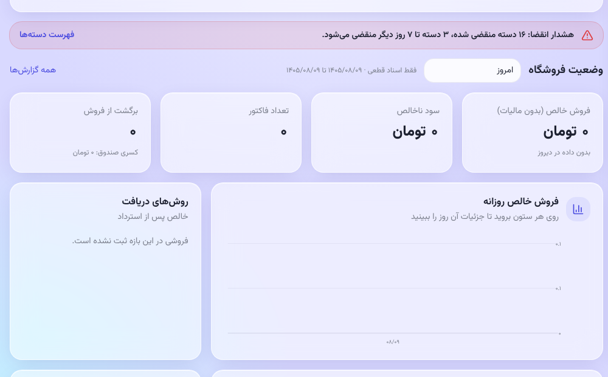

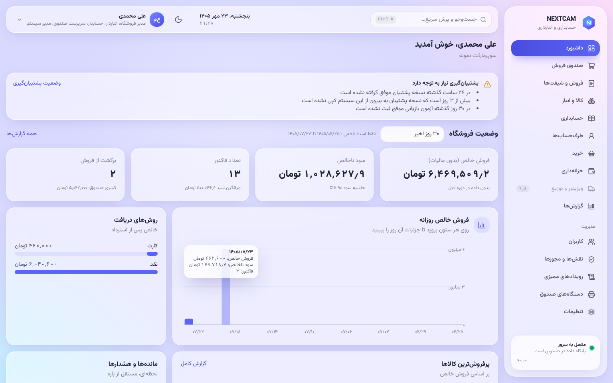

## فاکتورهای فروش
- **«فروش ← فاکتورها»:** با رفتن روی هر فاکتور، پیش‌نمایش چاپی آن در ستون چپ دیده می‌شود. کلیک آن را نگه می‌دارد و دوبار کلیک جزئیات و برگشت را باز می‌کند.
- **جست‌وجو:** با شماره‌ی خودکار یا شماره‌ی دستی.
- **برگشت با صندوق‌دار:** با تأیید سرپرست روی صندوق انجام می‌شود. اگر می‌خواهید صندوق‌دار بی‌تأیید برگرداند، در «نقش‌ها و مجوزها» مجوز «برگشت از فروش» را به نقش صندوق‌دار بدهید.
- **کد کالای جدید:** فرم کالا کد عددی بعدی را پیشنهاد می‌کند. کد استاندارد شرکت را می‌توانید جایش بنویسید.

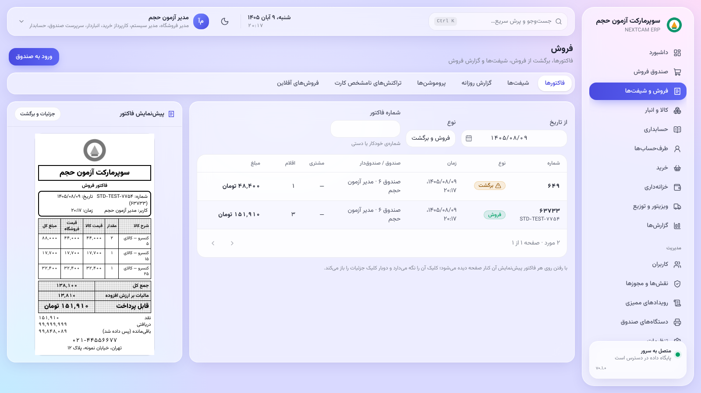

## گزارش‌ها
- **بازه‌ی گزارش** (بالای هر گزارش):
  - دکمه‌های **امروز، دیروز، این هفته، این ماه، ماه قبل، امسال**؛
  - **«یک روز»** برای یک تاریخ؛
  - **«از تاریخ» / «تا تاریخ»** برای بازه‌ی دلخواه، حداکثر یک سال؛
  - **«همه»** برای کل سابقه. روی داده‌ی زیاد کندتر است.
- **انتخاب تاریخ:** با کلیک روی هر خانه‌ی تاریخ (در همه‌ی صفحه‌ها) تقویم شمسی باز می‌شود. تایپ تاریخ هم مثل قبل ممکن است.

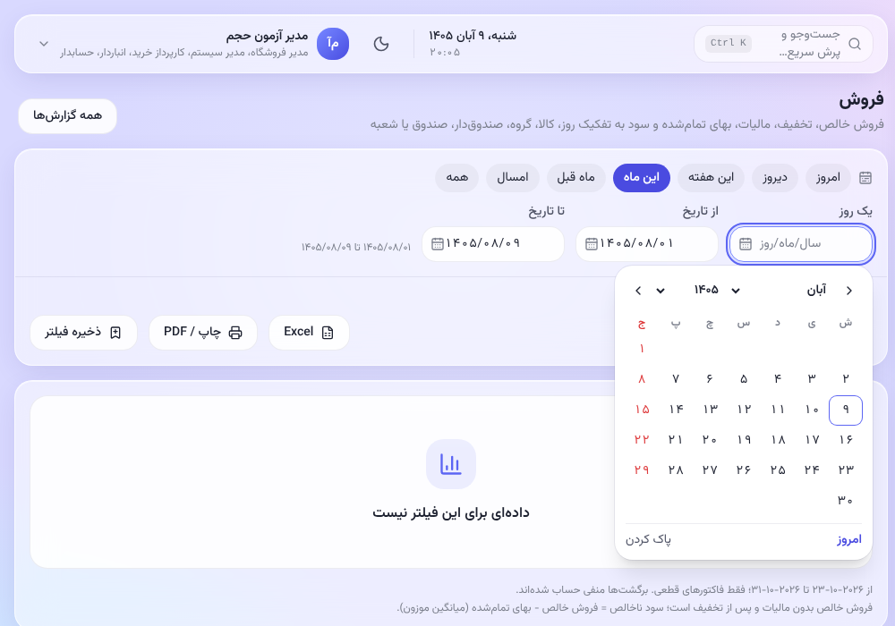

- **منوی «گزارش‌ها»:** فروش، کسری صندوق، گردش کالا، کم‌گردش، نزدیک انقضا، بدهکاران و بستانکاران، گردش وجوه، سود و زیان، ترازنامه، عملکرد ویزیتورها.
- **فیلترها:** هر فیلتر را می‌توان با نام ذخیره کرد.
- **خروجی:** چاپ یا PDF از مرورگر، و Excel.
- **گزارش فروش** بر اساس روز، کالا، گروه، صندوق‌دار، صندوق یا شعبه گروه‌بندی می‌شود.

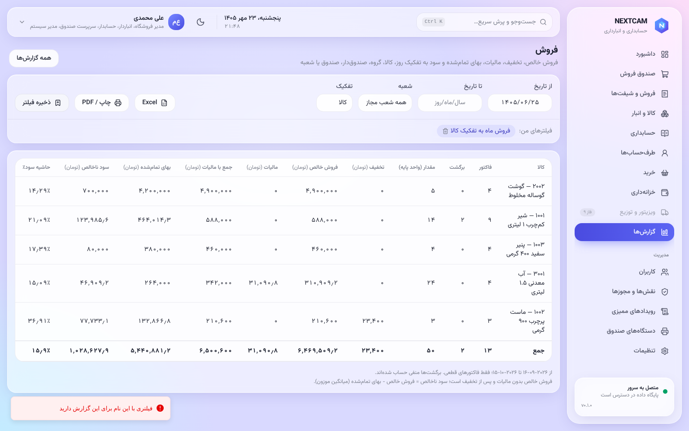

## قیمت و پروموشن
- **قیمت کالا:** در «کالاها».
- **پروموشن‌ها** («فروش و شیفت‌ها ← پروموشن‌ها»): تخفیف درصدی یا مبلغی برای کالا یا گروه، با بازه‌ی زمانی.
- **محاسبه:** صندوق خودش پروموشن را اعمال می‌کند؛ صندوق‌دار تخفیف نمی‌دهد (تصمیم مالک).

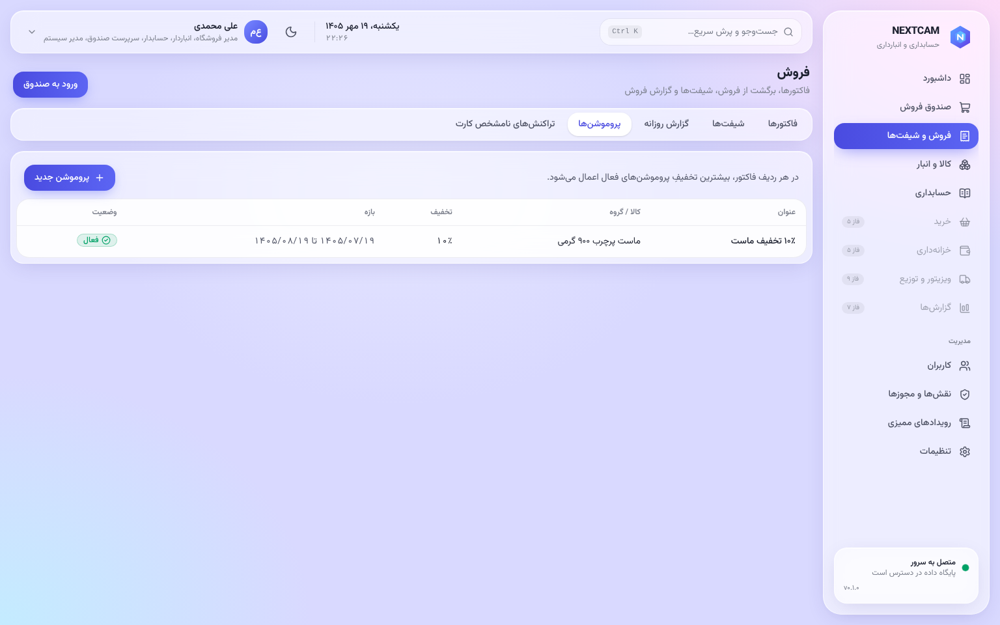

## ویزیتور و پخش
1. **ویزیتورها:**
   - تعریف ویزیتور برای کاربر دارای نقش «ویزیتور»؛
   - تخصیص مشتری‌ها و روز بازدید. **«افزودن همه‌ی مشتریان»** همه‌ی مشتریان فعال را یک‌جا اضافه می‌کند (روز بازدید مشتریان فعلی تغییر نمی‌کند). مشتریانی که بعداً تعریف می‌شوند خودکار اضافه نمی‌شوند؛ دوباره همین دکمه را بزنید. **«حذف همه»** فهرست را پیش از ذخیره خالی می‌کند.
2. **سفارش‌ها:** سفارش ویزیتور با قیمت سرور ثبت می‌شود و این مراحل را طی می‌کند:
   1. **بررسی:** تأیید (کنترل سقف اعتبار) یا رد با دلیل.
   2. **صدور فاکتور:** فاکتور نسیه‌ی معمولی با خروج کالا.
   3. **تحویل.**
3. **بازدیدها** و گزارش **عملکرد ویزیتورها**. بازدیدی که با مکان ثبت شده، پیوند نقشه دارد.
4. **هدف ماه:** در «هدف فروش» برای هر ویزیتور مبلغ هدف ماه شمسی را بگذارید. پیشرفت با مبلغ فاکتورشده سنجیده می‌شود و ویزیتور آن را در اپ می‌بیند.
5. **مشتری جدید:** ویزیتور مغازه‌ی تازه را از اپ می‌فرستد. با «تأیید» (کد و اعتبار را تعیین کنید) طرف‌حساب ساخته و به همان ویزیتور تخصیص داده می‌شود؛ «رد» با دلیل.
6. **وصول وجه:** وصول‌های ویزیتور را حسابدار تأیید می‌کند ([راهنمای حسابدار](accountant.md#وصول-ویزیتورها)).

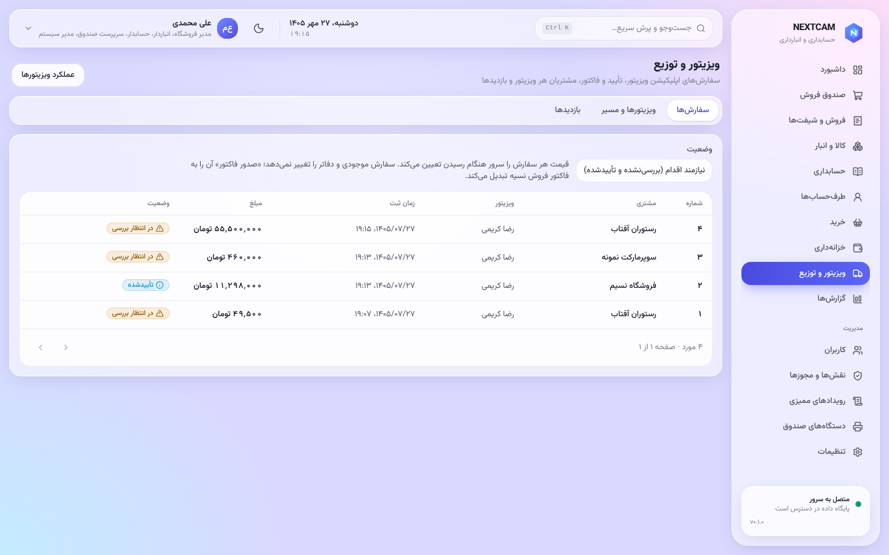

## دستگاه‌های صندوق
- **«دستگاه‌های صندوق»:** تعریف Device Agent هر صندوق، کد جفت‌سازی، چاپ آزمایشی، وضعیت اتصال و صف آفلاین.
- **باطل کردن دستگاه:** برای رایانه‌ی گم‌شده یا جابه‌جاشده.
- **کارت‌خوان‌های بانکی** (پایین همان صفحه): هر کارت‌خوان را با نام، شرکت ارائه‌دهنده، IP دستگاه، شعبه و **صندوق پیش‌فرض** تعریف کنید. صندوق‌دار هنگام پرداخت از کارت‌خوان‌های همان شعبه یکی را انتخاب می‌کند.
  - **سامان، پی‌سی‌پوز مرکزی:**
    - فقط نام، **شماره‌ی ترمینال**، شعبه و صندوق پیش‌فرض را وارد کنید.
    - نشانی سرویس و رمزهایی که سامان می‌دهد، روی سرور تنظیم می‌شوند (راهنمای نصب).
    - دستگاه باید از سوی سامان برای این سرویس فعال شده باشد.
    - تا آزمون با ترمینال آزمایشی سامان، این ارتباط «آزمایش‌نشده» است.
  - **سامان، SSP1126 در شبکه‌ی فروشگاه:** هنوز مستند پروتکل ندارد. صفحه‌ی پرداخت شماره‌ی پیگیری دستی می‌گیرد.

- **چاپ فاکتور («تنظیمات ← کاغذ پیش‌فرض چاپ فاکتور»):**
  - فیش حرارتی ۸۰ میلی‌متری پیش‌فرض است.
  - **«فاکتور فروش A5 / A4»** به الگوی نمونه‌ی فروشگاه:
    - لوگو، شماره و تاریخ؛
    - ارائه‌دهنده و خریدار با تلفن و کد اقتصادی؛
    - جدول ردیف‌دار؛
    - مبلغ به حروف؛
    - قیمت کل، پرداختی و مانده؛
    - مهر و امضا.
  - **«صورتحساب رسمی (A4 افقی)»:** «صورتحساب فروش کالا و خدمات» با:
    - مشخصات کامل فروشنده و خریدار؛
    - مالیات هر ردیف؛
    - جمع به حروف؛
    - نقدی یا غیرنقدی.

    شماره اقتصادی، شناسه ملی، شماره ثبت و کد پستی فروشگاه را در «تنظیمات ← مشخصات فروشنده در صورتحساب رسمی» وارد کنید. مشخصات خریدار از طرف‌حساب می‌آید.
  - مبالغ فاکتورهای A5، A4 و رسمی به **ریال** است.
  - در صفحه‌ی هر فاکتور می‌توانید کاغذ دیگری انتخاب و دوباره چاپ کنید.
  - تلفن و نشانی فیش از «تنظیمات ← درباره ما» می‌آید و متن پایین فیش از «متن پایین فیش».

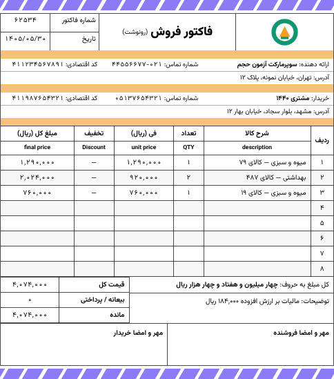

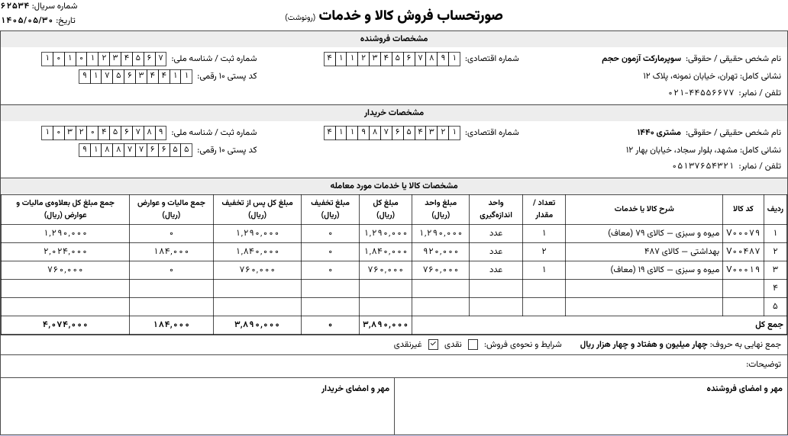

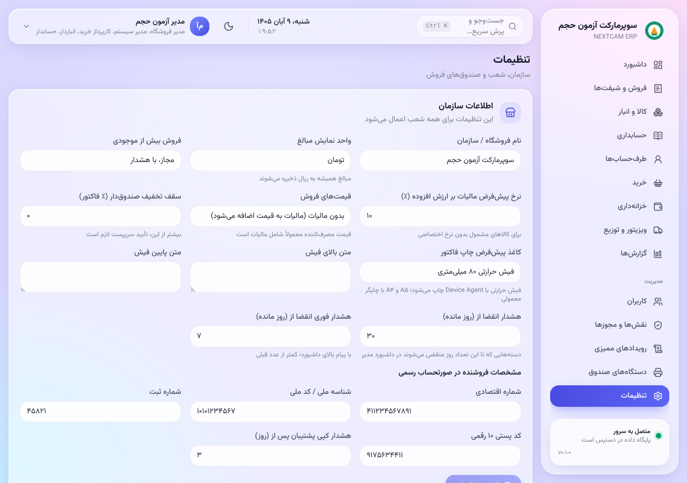

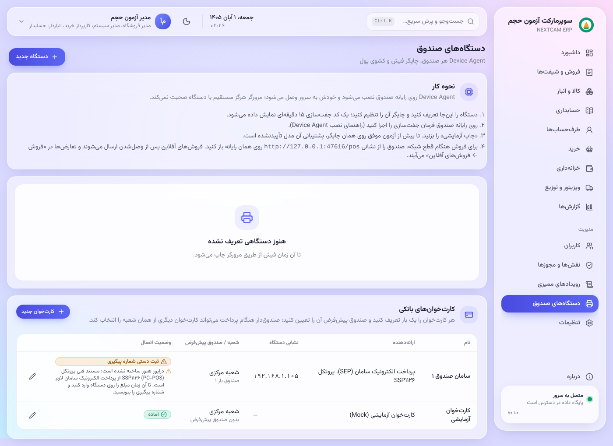 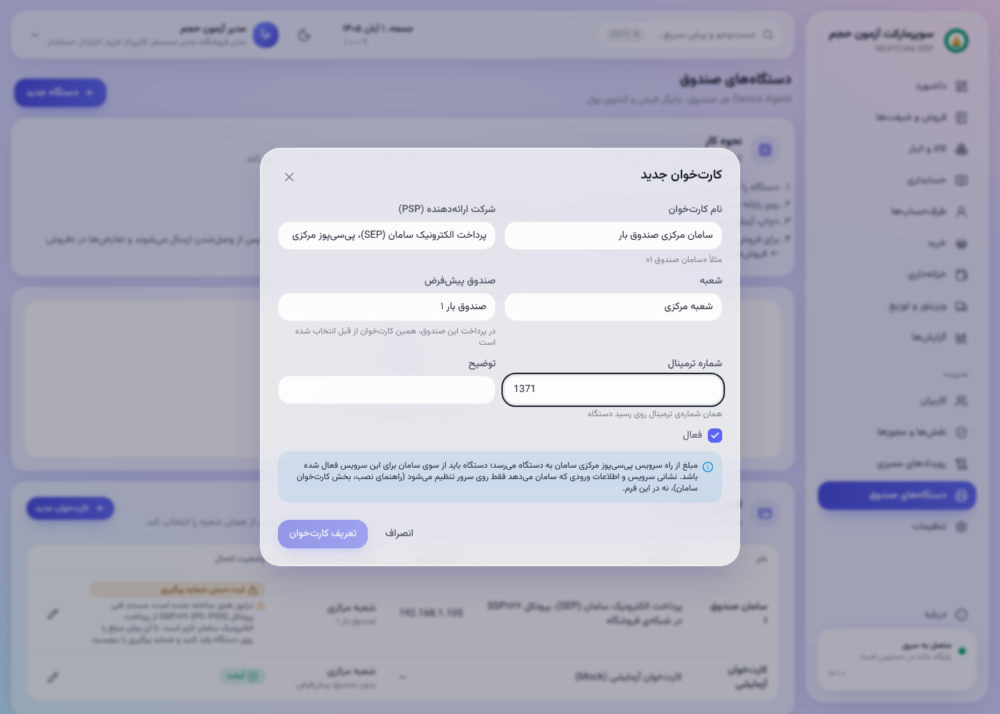

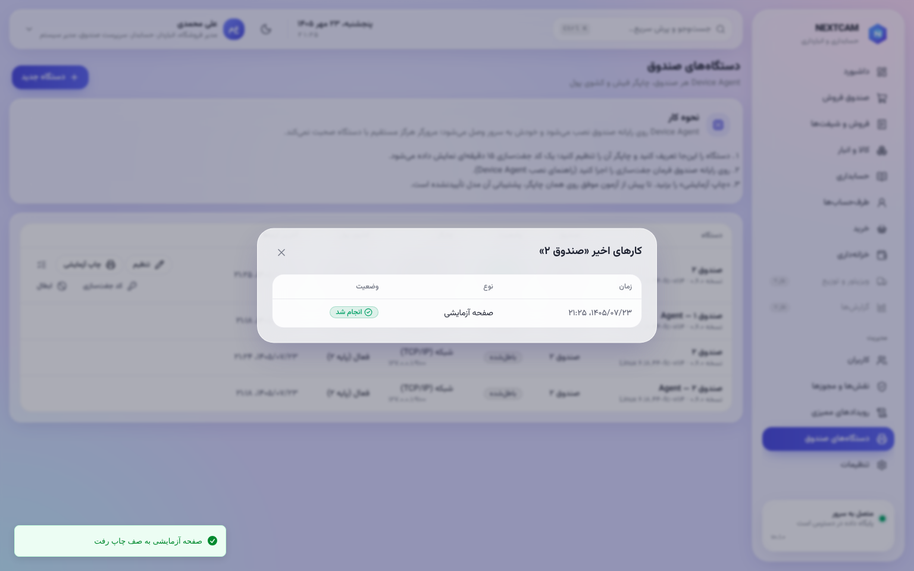
