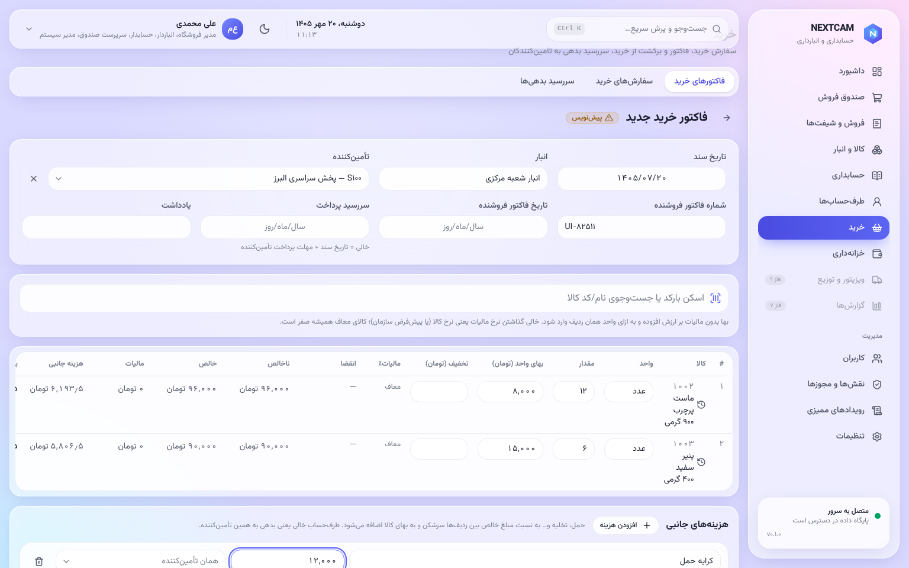
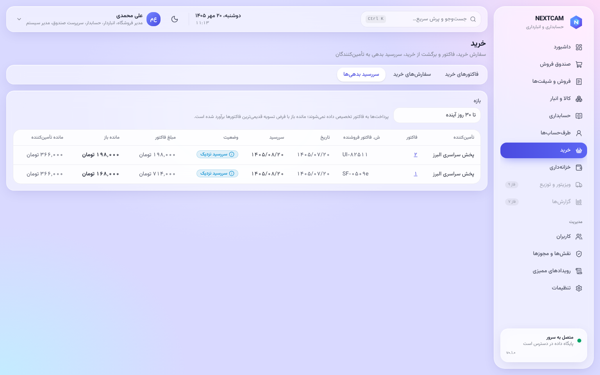

# راهنمای کارپرداز خرید

منوها: **خرید** و **طرف‌حساب‌ها**.

## تأمین‌کننده
**«طرف‌حساب‌ها ← طرف‌حساب جدید»**، با گزینه‌ی «تأمین‌کننده». این اطلاعات را وارد کنید:
- شناسه‌ی ملی؛
- تماس؛
- مهلت پرداخت (روز).

## سفارش خرید (اختیاری)
- **«سفارش‌ها»:** ثبت سفارش برای پیگیری.
- سفارش به موجودی و دفاتر دست نمی‌زند.
- فاکتور را می‌توان از روی سفارش ساخت.

## فاکتور خرید
1. **«فاکتورهای خرید ← فاکتور جدید»:** تأمین‌کننده، انبار، تاریخ و شماره‌ی فاکتور فروشنده.
2. **ردیف‌ها:** کالا، مقدار (با واحد خرید، مثلاً کارتن)، بهای واحد، تخفیف ردیف.
3. **هزینه‌های جانبی** (کرایه، تخلیه، …):
   - بین ردیف‌ها به نسبت ارزش سرشکن و به بهای تمام‌شده اضافه می‌شوند؛
   - هر هزینه می‌تواند دریافت‌کننده‌ی جدا داشته باشد (مثلاً باربری).
4. **پیش‌نمایش:** بهای تمام‌شده‌ی هر ردیف را پیش از ثبت نشان می‌دهد.
5. **قطعی کردن** این کارها را انجام می‌دهد:
   - ورود کالا به انبار؛
   - سند حسابداری بدهی به تأمین‌کننده؛
   - ثبت سررسید پرداخت.
6. اصلاح فاکتور قطعی فقط با **برگشت از خرید** ممکن است.

## سررسیدها
- **«سررسیدها»:** فاکتورهایی که موعد پرداختشان نزدیک یا گذشته است.
- پرداخت را خزانه‌داری ثبت می‌کند.

