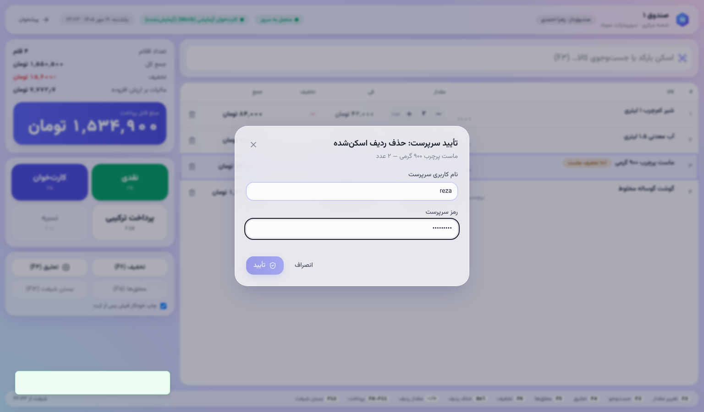
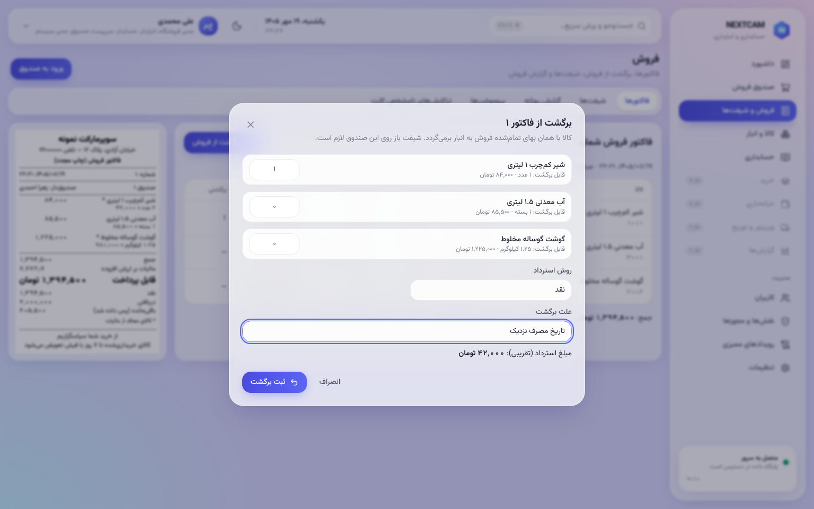
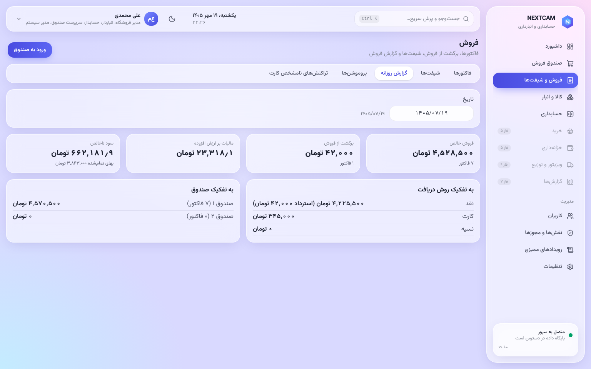
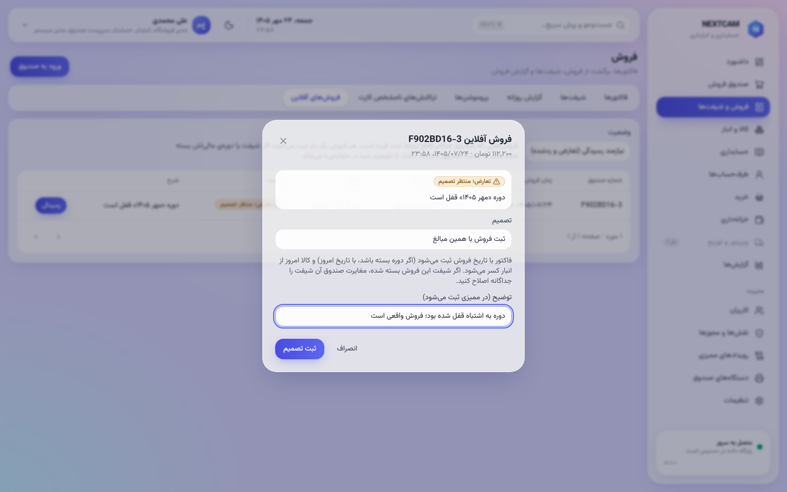

# راهنمای سرپرست صندوق

همه‌ی کارهای صندوق‌دار ([cashier.md](cashier.md))، به‌علاوه‌ی موارد زیر.

## تأیید روی صندوق
- **تخفیف دستی بالاتر از سقف صندوق‌دار:** صندوق‌دار درخواست می‌دهد و سرپرست با نام کاربری و رمز خودش، روی همان صندوق تأیید می‌کند.
- تأیید برای همان سبد و همان صندوق است و در رویدادنگار ثبت می‌شود.

## برگشت از فروش
1. «فروش و شیفت‌ها ← فاکتورها»: فاکتور را با شماره یا تاریخ پیدا کنید.
2. «برگشت»:
   - ردیف‌ها و مقدار برگشتی را انتخاب کنید (بیش از مقدار فروخته‌شده ممکن نیست)؛
   - روش بازپرداخت و **دلیل** را وارد کنید.
3. **سند برگشت:** فاکتور اصلی تغییر نمی‌کند. یک سند برگشت با شماره‌ی جدا ساخته می‌شود و موجودی و دفاتر خودکار اصلاح می‌شوند.

## شیفت‌ها و گزارش روزانه
- «فروش و شیفت‌ها ← شیفت‌ها» و «گزارش روزانه»: فروش هر صندوق به تفکیک روش پرداخت، و کسری و اضافه‌ی شمارش.

## کارت‌خوان و فروش آفلاین
- **«تراکنش‌های کارت»:** پرداخت‌های «نامشخص» را با رسید یا گزارش بانک تعیین تکلیف کنید.
- **«فروش‌های آفلاین»:** فروش‌هایی که سرور نپذیرفته (تعارض) با جزئیات کامل نمایش داده می‌شوند. یکی از این کارها را انجام دهید:
  - ثبت با تأیید؛
  - کنار گذاشتن با دلیل.

  هیچ‌کدام خودکار انجام نمی‌شود.

