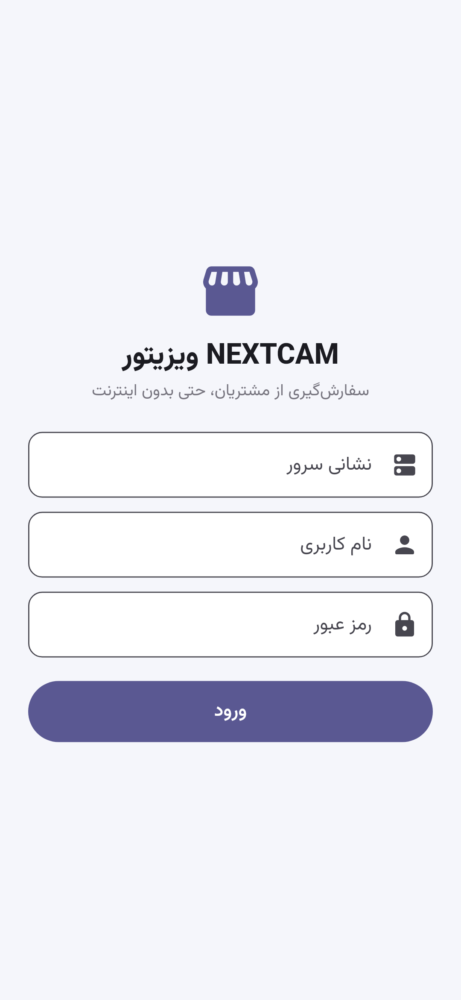
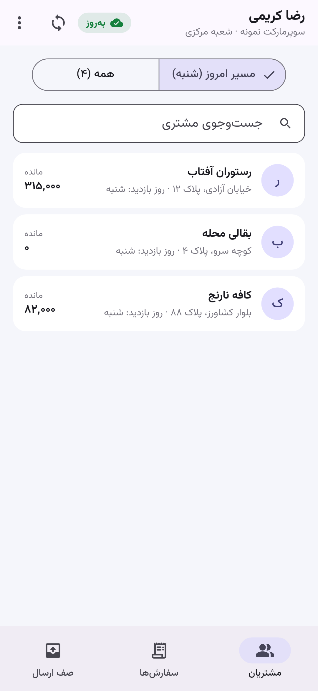
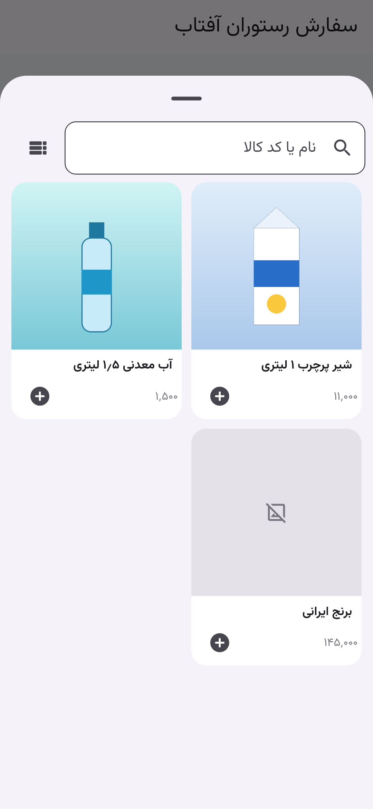
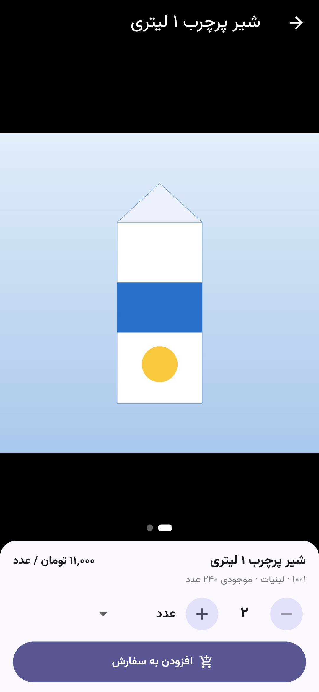
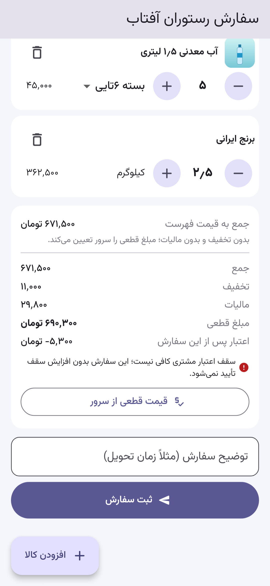
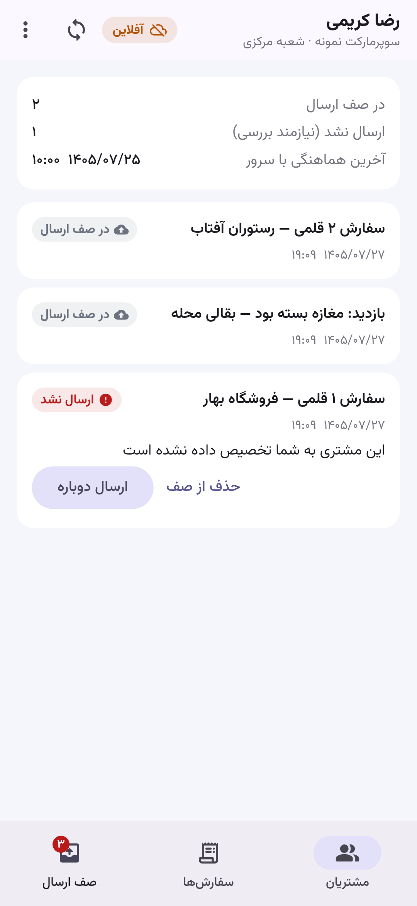

# راهنمای اپ ویزیتور (اندروید)

نصب و اتصال: [../install/visitor-app.md](../install/visitor-app.md). اپ فقط با **HTTPS** به سرور وصل می‌شود (Q21).

## ورود
- با نام کاربری و رمز خودتان وارد شوید. فقط کاربر دارای نقش «ویزیتور» می‌تواند وارد شود.
- نشست تا ۳۰ روز می‌ماند. با «خروج» یا غیرفعال شدن حساب توسط مدیر، فوراً قطع می‌شود.

## مشتری‌های امروز
فهرست مشتری‌هایی که امروز روز بازدیدشان است. «همه» فهرست کامل را نشان می‌دهد. برای هر مشتری این‌ها نمایش داده می‌شود:
- مانده؛
- سقف اعتبار؛
- سفارش‌های قبلی.

## ثبت سفارش
1. **«افزودن کالا»:** کالاها با عکس نمایش داده می‌شوند (دکمه‌ی بالای فهرست بین «با عکس» و «فهرستی» جابه‌جا می‌کند). با نام یا کد جست‌وجو کنید.
   - **دکمه‌ی + روی هر کالا:** یک واحد به سفارش اضافه می‌شود.
   - **زدن روی عکس:** عکس تمام‌صفحه برای نشان دادن به خریدار باز می‌شود. با کشیدن، عکس‌های دیگر کالا دیده می‌شوند و با دو انگشت بزرگ می‌شوند. همان‌جا واحد و مقدار را انتخاب کنید و «افزودن به سفارش» را بزنید.
   - در سفارش هم با زدن روی عکس کوچک هر ردیف، عکس بزرگ باز می‌شود.
2. **قیمت قطعی را فقط سرور تعیین می‌کند:**
   - **آنلاین:** «قیمت از سرور» نمایش داده می‌شود.
   - **آفلاین:** فقط «برآورد به قیمت فهرست» نمایش داده می‌شود.
3. ثبت سفارش انجام می‌شود. بدون اینترنت، سفارش در صف گوشی می‌ماند و پس از اتصال خودکار ارسال می‌شود. **هیچ‌وقت دوبار ثبت نمی‌شود.**
4. **ثبت بازدید بی‌سفارش:** «بازدید بدون سفارش» با دلیل (بسته بود، موجودی داشت، …).

 

 

### عکس‌ها بدون اینترنت
- عکس‌های کوچک همه‌ی کالاها با هر همگام‌سازی روی گوشی ذخیره می‌شوند.
- عکس بزرگ با اولین بار نمایش ذخیره می‌شود.
- پیش از رفتن به مسیری بدون اینترنت، از منوی ⋮ گزینه‌ی **«دریافت عکس‌ها برای کار بدون اینترنت»** را بزنید (ترجیحاً با Wi-Fi). عکس اصلی همه‌ی کالاها دریافت می‌شود.
- عکسی که روی گوشی نیست فقط با علامت جای عکس نشان داده می‌شود؛ ثبت سفارش هیچ‌وقت منتظر عکس نمی‌ماند.

## وضعیت سفارش‌ها
- **وضعیت‌ها:** بررسی‌نشده، تأییدشده، ردشده (با دلیل)، فاکتورشده، تحویل‌شده.
- **لغو:** سفارش بررسی‌نشده را خود ویزیتور می‌تواند لغو کند.
