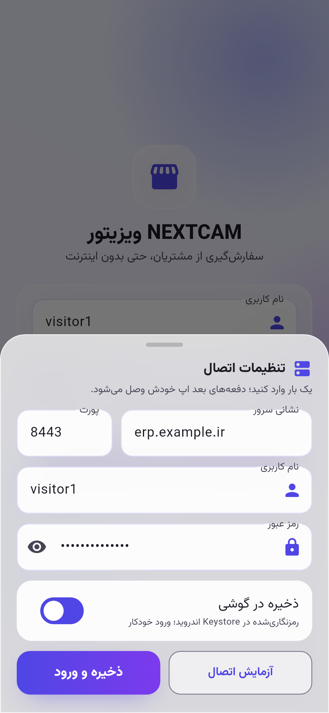
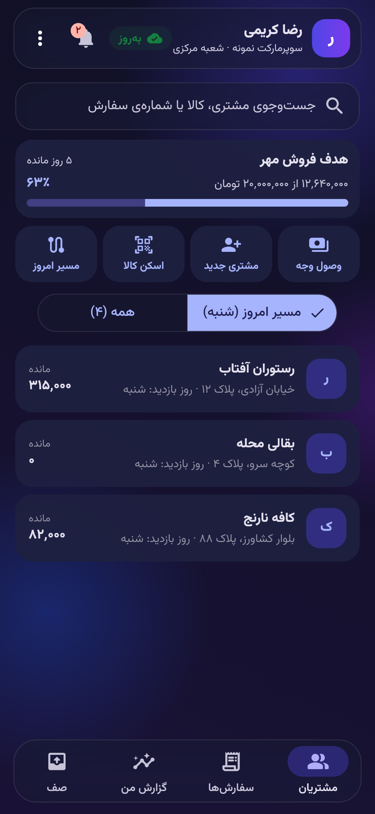
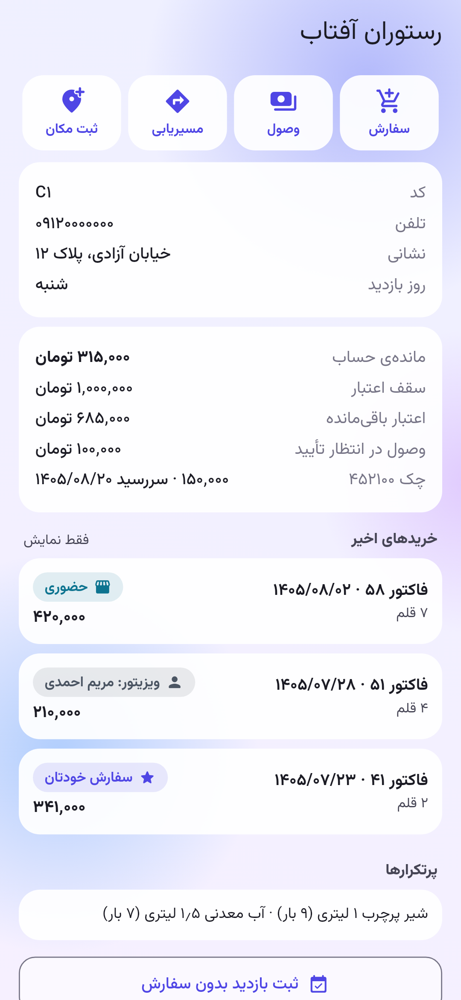
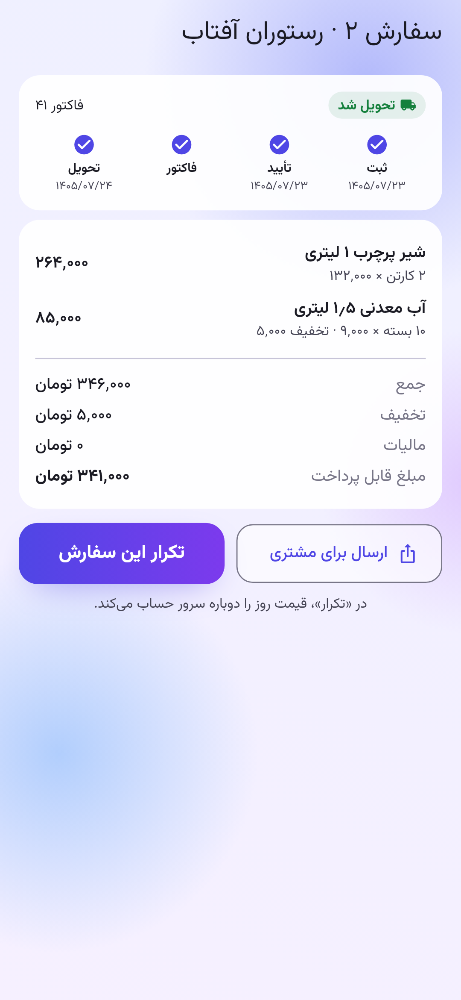
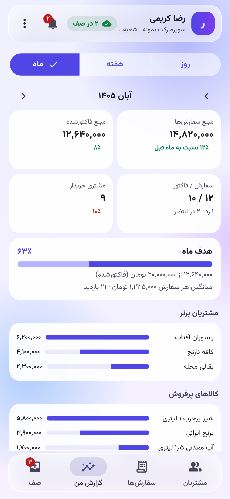
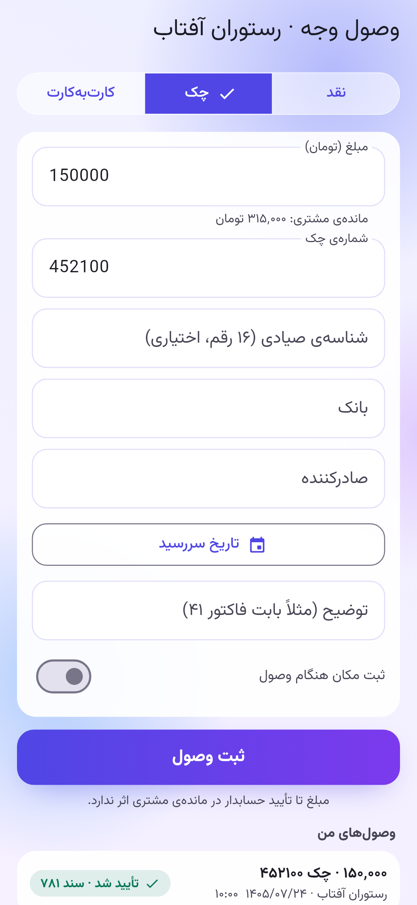
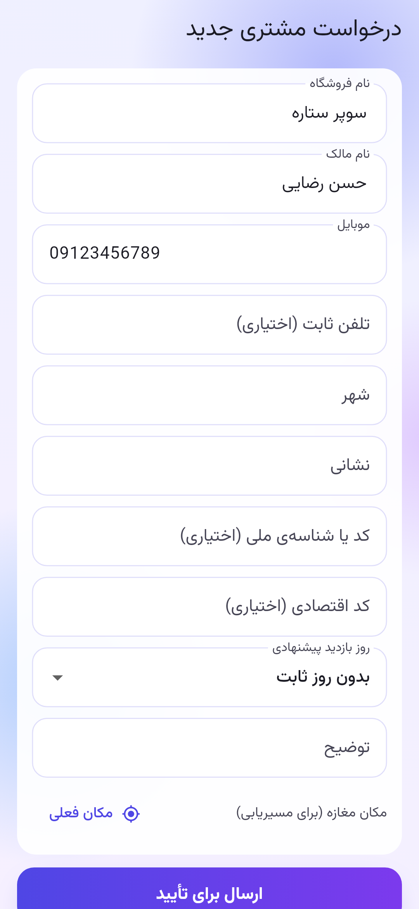

# راهنمای اپ ویزیتور (اندروید)

نصب و اتصال: [../install/visitor-app.md](../install/visitor-app.md). اپ فقط با **HTTPS** به سرور وصل می‌شود (Q21).

## ورود
- **بار اول:** «تنظیمات اتصال» را بزنید و این‌ها را وارد کنید:
  - نشانی سرور، مثلاً `erp.example.ir`؛
  - پورت (خالی یعنی ۴۴۳)؛
  - نام کاربری و رمز.
  - «آزمایش اتصال» فقط بررسی می‌کند سرور NEXTCAM پاسخ می‌دهد. «ذخیره و ورود» وارد می‌شود و تنظیمات را نگه می‌دارد.
- فقط کاربر دارای نقش «ویزیتور» می‌تواند وارد شود.
- **ذخیره در گوشی** (پیش‌فرض روشن):
  - رمز به‌صورت رمزنگاری‌شده در Keystore اندروید می‌ماند و اپ با باز شدن خودش وصل می‌شود.
  - نشست ۳۰ روزه است. وقتی تمام شود، اپ بی‌صدا با همان رمز دوباره وارد می‌شود.
  - اگر رمز در سرور عوض شده باشد، رمز ذخیره‌شده پاک می‌شود و یک بار باید دستی وارد شوید.
- **خروج** رمز ذخیره‌شده را پاک می‌کند. نشانی، پورت و نام کاربری می‌مانند.
- **گوشی گم شد؟** در پنل، رمز آن ویزیتور را عوض کنید یا حسابش را غیرفعال کنید. ورود خودکار از آن گوشی از کار می‌افتد.

 

## ظاهر
- طرح شیشه‌ای (گلس‌مورفیسم): شیشه فقط برای قاب‌هاست و فهرست‌ها روی سطح مات می‌مانند تا زیر نور آفتاب خوانا باشند.
- حالت تیره با تنظیم گوشی عوض می‌شود.
- برای گوشی‌های ضعیف، منوی ⋮ ← «حالت سبک» جلوه‌ی شیشه را برمی‌دارد.

## صفحه‌ی اصلی
- چهار زبانه: **مشتریان**، **سفارش‌ها**، **گزارش من**، **صف** (موارد ارسال‌نشده).
- **هدف ماه:** اگر مدیر برای این ماه هدف گذاشته باشد، کارت پیشرفت (بر اساس مبلغ فاکتورشده) بالای فهرست است.
- **دکمه‌های سریع:** وصول وجه، مشتری جدید، اسکن کالا، مسیر امروز.
- **زنگوله:** اعلان‌ها با شمار نخوانده‌ها.

## جست‌وجو
نوار «جست‌وجو» بالای صفحه هم‌زمان در **مشتریان، کالاها و سفارش‌ها** می‌گردد (نام، کد، شماره‌ی سفارش). «ي» و «ك» عربی و ارقام فارسی و انگلیسی یکسان حساب می‌شوند. بدون اینترنت هم کار می‌کند.

## صفحه‌ی مشتری
- **دکمه‌ها:** سفارش، وصول، مسیریابی (باز کردن نقشه‌ی گوشی)، ثبت مکان مغازه.
- **حساب مشتری:** مانده، سقف و اعتبار باقی‌مانده، چک‌های برگشتی یا سررسیدنشده و صورت‌حساب اخیر.
- **سوابق خرید:** فاکتورهای قبلی مشتری، **حتی خرید حضوری از فروشگاه و سفارش ویزیتورهای دیگر**. کنار هر فاکتور مشخص است که از کجا آمده:
  - «سفارش خودتان»؛
  - «حضوری»؛
  - «ویزیتور: <نام>» برای سفارش ویزیتور دیگر.
  - این سوابق **فقط برای دیدن** است. با زدن روی هر فاکتور، اقلام آن باز می‌شود. فقط سفارش‌های خودتان «تکرار این سفارش» دارند.
- **پرتکرارها:** کالاهایی که این مشتری بیشتر می‌خرد.
- **بازدید بدون سفارش** با دلیل: بسته بود، موجودی داشت، قیمت بالا، مشکل اعتبار، مالک نبود، …

## ثبت سفارش
1. **«افزودن کالا»:** کالاها با عکس نمایش داده می‌شوند (دکمه‌ی بالای فهرست بین «با عکس» و «فهرستی» جابه‌جا می‌کند). با نام یا کد جست‌وجو کنید.
   - **دکمه‌ی + روی هر کالا:** یک واحد به سفارش اضافه می‌شود.
   - **زدن روی عکس:** عکس تمام‌صفحه برای نشان دادن به خریدار باز می‌شود. با کشیدن، عکس‌های دیگر کالا دیده می‌شوند و با دو انگشت بزرگ می‌شوند. همان‌جا واحد و مقدار را انتخاب کنید و «افزودن به سفارش» را بزنید.
   - در سفارش هم با زدن روی عکس کوچک هر ردیف، عکس بزرگ باز می‌شود.
2. **قیمت قطعی را فقط سرور تعیین می‌کند:**
   - **آنلاین:** «قیمت از سرور» نمایش داده می‌شود.
   - **آفلاین:** فقط «برآورد به قیمت فهرست» نمایش داده می‌شود.
3. ثبت سفارش انجام می‌شود. بدون اینترنت، سفارش در صف گوشی می‌ماند و پس از اتصال خودکار ارسال می‌شود. **هیچ‌وقت دوبار ثبت نمی‌شود.**
4. **اسکن بارکد:** دکمه‌ی اسکن در سفارش (و «اسکن کالا» در صفحه‌ی اصلی) با دوربین بارکد کالا را می‌خواند. اگر بارکد مال کارتن باشد، همان واحد انتخاب می‌شود.

 

 

### عکس‌ها بدون اینترنت
- عکس‌های کوچک همه‌ی کالاها با هر همگام‌سازی روی گوشی ذخیره می‌شوند.
- عکس بزرگ با اولین بار نمایش ذخیره می‌شود.
- پیش از رفتن به مسیری بدون اینترنت، از منوی ⋮ گزینه‌ی **«دریافت عکس‌ها برای کار بدون اینترنت»** را بزنید (ترجیحاً با Wi-Fi). عکس اصلی همه‌ی کالاها دریافت می‌شود.
- عکسی که روی گوشی نیست فقط با علامت جای عکس نشان داده می‌شود؛ ثبت سفارش هیچ‌وقت منتظر عکس نمی‌ماند.

## وضعیت سفارش‌ها
- **وضعیت‌ها:** بررسی‌نشده، تأییدشده، ردشده (با دلیل)، فاکتورشده، تحویل‌شده.
- **لغو:** سفارش بررسی‌نشده را خود ویزیتور می‌تواند لغو کند.
- **جزئیات سفارش:** با زدن روی هر سفارش، مراحل (ثبت، تأیید، فاکتور، تحویل)، اقلام و مبلغ دیده می‌شود.
  - **تکرار این سفارش:** همان اقلام را در سفارش تازه می‌گذارد (قیمت دوباره از سرور گرفته می‌شود).
  - **پیش‌فاکتور:** تصویر پیش‌فاکتور برای فرستادن به مشتری با واتس‌اپ، تلگرام یا هر برنامه‌ی دیگر. این تصویر سند رسمی نیست.

## گزارش من
- **روز، هفته (از شنبه) یا ماه شمسی**، با دکمه‌های دوره‌ی قبل و بعد و مقایسه با دوره‌ی قبل.
- **مبلغ سفارش‌ها:** همه‌ی سفارش‌های ثبت‌شده در دوره، به‌جز ردشده و لغوشده.
- **مبلغ فاکتورشده:** آن‌چه واقعاً فاکتور شد (به تاریخ فاکتور). پیشرفت هدف ماه با همین مبلغ است.
- شمار سفارش و فاکتور، ردشده و در انتظار، شمار مشتریان خریدار، میانگین هر سفارش، بازدیدها.
- مشتریان برتر، کالاهای پرفروش و دلیل‌های بازدید بدون سفارش.
- **فقط سفارش‌های خود ویزیتور حساب می‌شود.** خرید حضوری و سفارش ویزیتور دیگر در گزارش او نیست.
- گزارشی که یک بار دیده شده بدون اینترنت هم (با برچسب «بدون اینترنت: آخرین داده‌ی ذخیره‌شده») نمایش داده می‌شود.

## وصول وجه
- از صفحه‌ی مشتری یا «وصول وجه»: **نقد، چک یا کارت‌به‌کارت**. برای چک: شماره، شناسه‌ی صیادی، بانک، صادرکننده و تاریخ سررسید.
- وصول ویزیتور فقط یک **درخواست** است و **تا تأیید حسابدار در مانده‌ی مشتری اثری ندارد**. حسابدار با تأیید، سند دریافت را در خزانه‌داری ثبت می‌کند.
- وضعیت هر وصول (در انتظار، تأییدشده با شماره‌ی سند، ردشده با دلیل) در «وصول‌های من» است.

## مشتری جدید
- مغازه‌ی تازه را با نام، مالک، موبایل، نشانی، کد ملی یا اقتصادی و مکان ثبت کنید.
- درخواست به مدیر می‌رود. پس از تأیید، مشتری ساخته می‌شود و به فهرست همین ویزیتور اضافه می‌شود.

## اعلان‌ها
- تأیید یا رد سفارش، فاکتور و تحویل، تأیید یا رد وصول و مشتری جدید، و هدف تازه‌ی ماه.
- اعلان‌ها با هر همگام‌سازی دریافت می‌شوند و روی گوشی هم اعلان نشان داده می‌شود. ⚠️ اعلان فوری (Push) نیست: تا اپ همگام نشود، اعلان نمی‌رسد.

## مکان (GPS)
- از منوی ⋮ ← «ثبت مکان بازدید و وصول» روشن یا خاموش می‌شود (پیش‌فرض خاموش).
- اگر روشن باشد، مکان گوشی همراه بازدید، سفارش و وصول فرستاده می‌شود و مدیر آن را در «بازدیدها» روی نقشه می‌بیند.
- «ثبت مکان» در صفحه‌ی مشتری مکان مغازه را برای مسیریابی ذخیره می‌کند.
