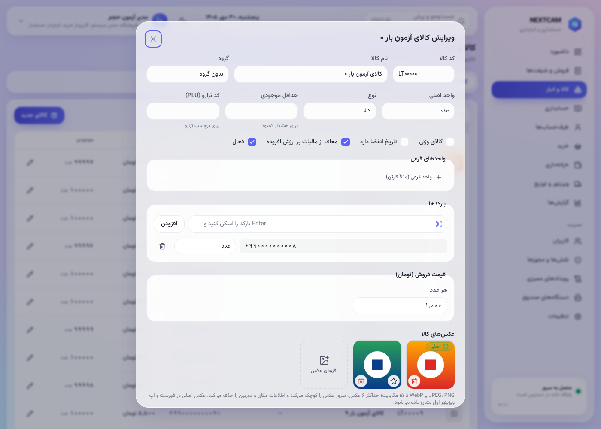
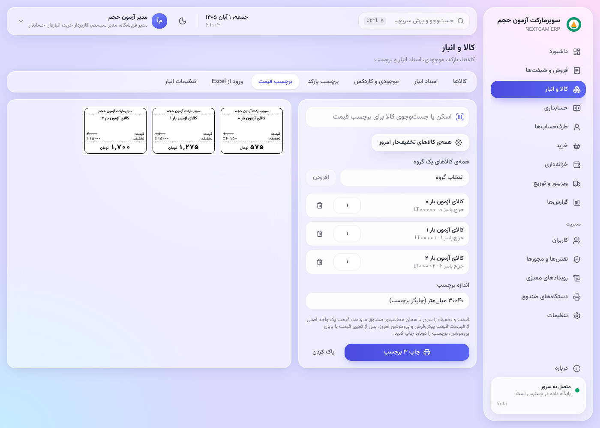
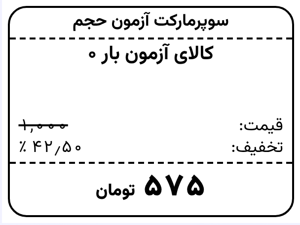
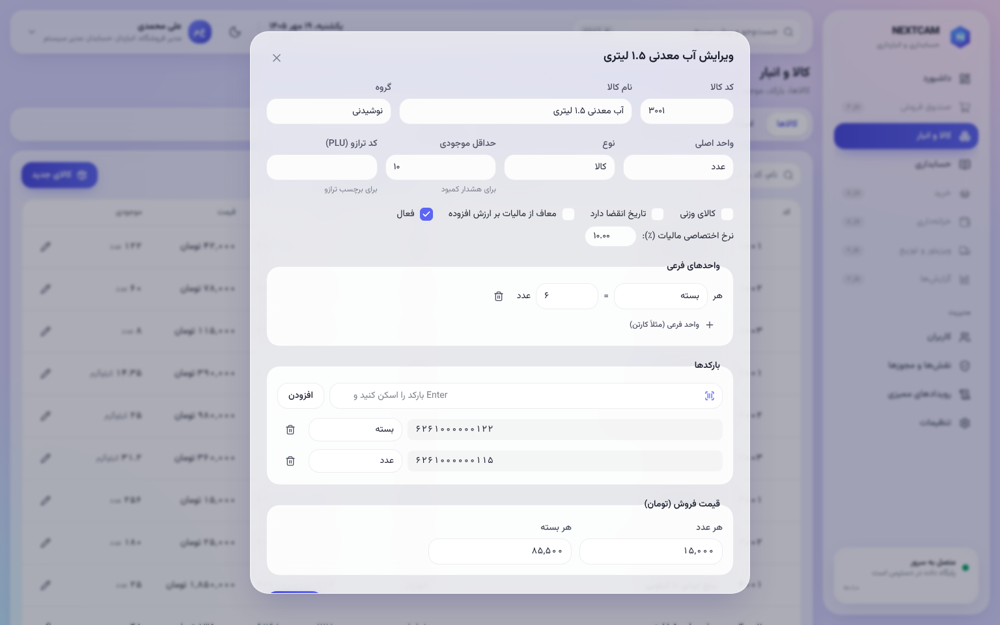
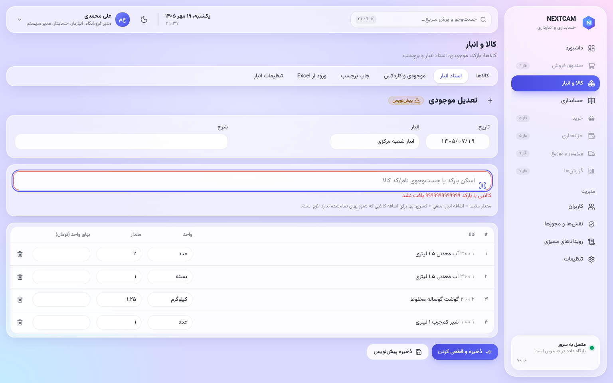
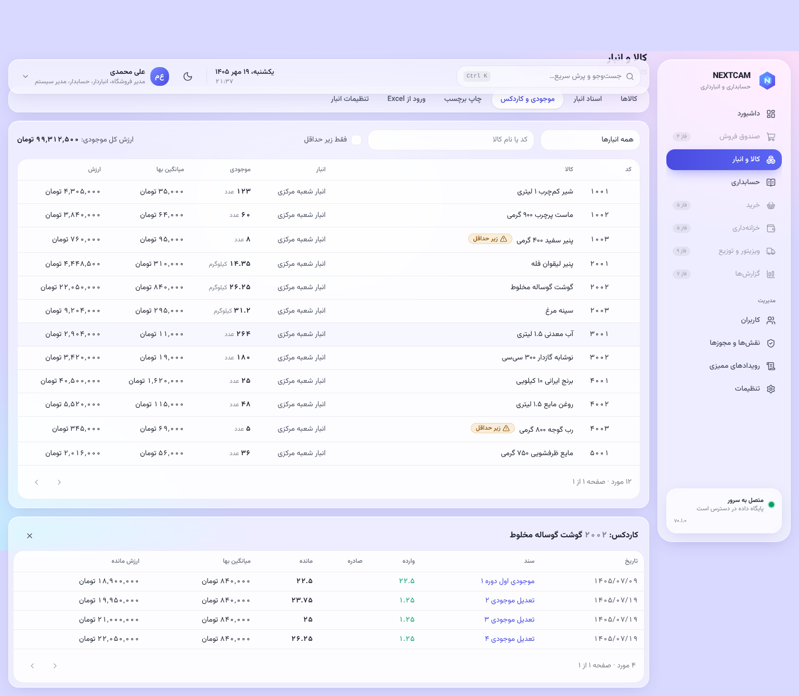
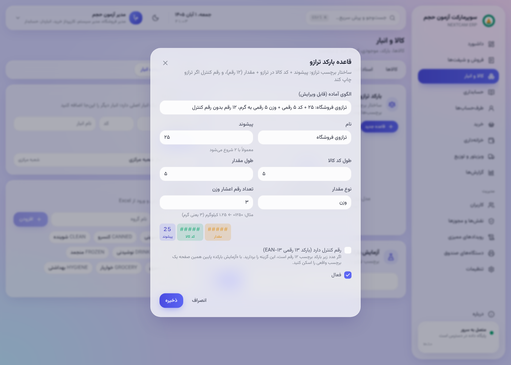

# راهنمای انباردار

منو: **کالا و انبار**.

## کالاها
- **«کالاها ← کالای جدید»:**
  - کد، نام، گروه و واحد پایه؛
  - بارکدها: چند بارکد برای یک کالا ممکن است، و بارکد تکراری پذیرفته نمی‌شود؛
  - واحدهای دیگر (مثلاً بسته‌ی ۶تایی با ضریب ۶)؛
  - قیمت فروش؛
  - معافیت یا نرخ مالیات؛
  - کالای وزنی و کد ترازو.
- **عکس کالا:** پس از ذخیره‌ی کالا، در ویرایش آن بخش «عکس‌های کالا» را ببینید.
  - تا ۶ عکس JPEG، PNG یا WebP، هر کدام تا ۱۵ مگابایت؛ چند عکس را با هم انتخاب کنید.
  - ⭐ یک عکس را **اصلی** می‌کند: در فهرست کالاها و اپ ویزیتور اول همان دیده می‌شود.
  - سرور عکس را کوچک می‌کند و اطلاعات مکان و دوربین را حذف می‌کند.

- **«ورود از Excel»:** فهرست کالاها یا موجودی اول دوره را از فایل نمونه وارد کنید. ابتدا پیش‌نمایش و خطاهای هر ردیف را ببینید، سپس ثبت کنید.
- **«برچسب بارکد»:** برچسب بارکد کالا برای کالای بدون بارکد کارخانه.
- **«برچسب قیمت»:** برچسب قفسه مثل نمونه‌ی فروشگاه (حدود ۴۰×۳۰ میلی‌متر).
  - هر برچسب این‌ها را دارد: نام فروشگاه، نام کالا، قیمت، درصد تخفیف و قیمت نهایی.
  - کالا را اسکن یا جست‌وجو کنید. «همه‌ی کالاهای تخفیف‌دار امروز» یا همه‌ی کالاهای یک گروه را هم می‌توانید اضافه کنید.
  - قیمت و تخفیف را سرور با همان محاسبه‌ی صندوق می‌دهد (یک واحد اصلی، فهرست قیمت پیش‌فرض، پروموشن امروز).
  - پس از تغییر قیمت یا پایان پروموشن، برچسب را دوباره چاپ کنید.

 

## اسناد انبار
در «اسناد انبار»، اسناد دستی این‌هاست:

| سند | کاربرد |
|---|---|
| موجودی اول دوره | ثبت موجودی آغاز، با بهای واحد |
| تعدیل | اصلاح کسری یا اضافه (نیاز به مجوز «تعدیل موجودی») |
| انتقال | جابه‌جایی بین انبارها |
| شمارش | ثبت شمارش؛ اختلاف خودکار تعدیل می‌شود |

- ردیف‌ها را با **اسکن بارکد** اضافه کنید.
- سند **پیش‌نویس** قابل ویرایش است. با **قطعی کردن**، موجودی و سند حسابداری ساخته می‌شوند و سند دیگر تغییر نمی‌کند.
- اسناد فروش، برگشت فروش، خرید و برگشت خرید را خود سیستم می‌سازد و در همین فهرست دیده می‌شوند.

## موجودی و کاردکس
- **«موجودی»:** مقدار، ارزش و میانگین بهای هر کالا در هر انبار.
- **کاردکس:** همه‌ی ورود و خروج‌ها با سند مبدأ.
- موجودی **فقط** از همین گردش تغییر می‌کند.
- بهای تمام‌شده به روش میانگین موزون محاسبه می‌شود.

## ترازو
- **«تنظیمات انبار ← قالب بارکد ترازو»:** پیشوند، طول کد کالا، وزن یا قیمت، و مقسوم‌علیه را مطابق برچسب ترازوی فروشگاه تنظیم کنید.
- **ترازوی فروشگاه (نمونه‌ی ۱۴۰۵/۰۸/۰۲):** الگوی آماده‌ی «ترازوی فروشگاه» را انتخاب کنید.
  - ساختار: پیشوند ۲۵، کد ۵ رقمی، وزن ۵ رقمی به گرم، ۱۲ رقم بدون رقم کنترل.
  - نمونه: `250212001442` یعنی کالای با کد ترازو ۰۲۱۲۰، ۱٫۴۴۲ کیلوگرم.
  - در تعریف کالای وزنی، «کد ترازو» را همان کدی بگذارید که در ترازو تعریف شده است.
- **«رقم کنترل دارد»:** اگر عدد زیر بارکد برچسب ۱۳ رقم است، آن را بزنید. اگر ۱۲ رقم است، آن را بردارید.
- قبل از استفاده، چند برچسب واقعی را در «آزمایش بارکد» با اسکنر صندوق اسکن کنید (Q3).

## گزارش‌ها
- **گردش کالا**؛
- **کالاهای کم‌گردش و راکد**؛
- **نزدیک انقضا** (برای کالاهای دارای تاریخ انقضا).
